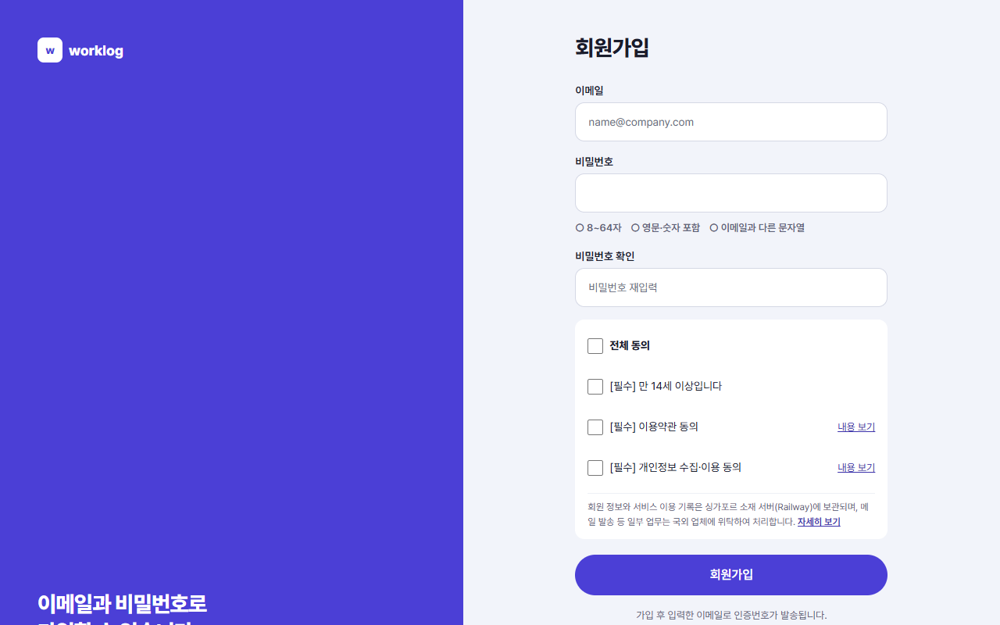
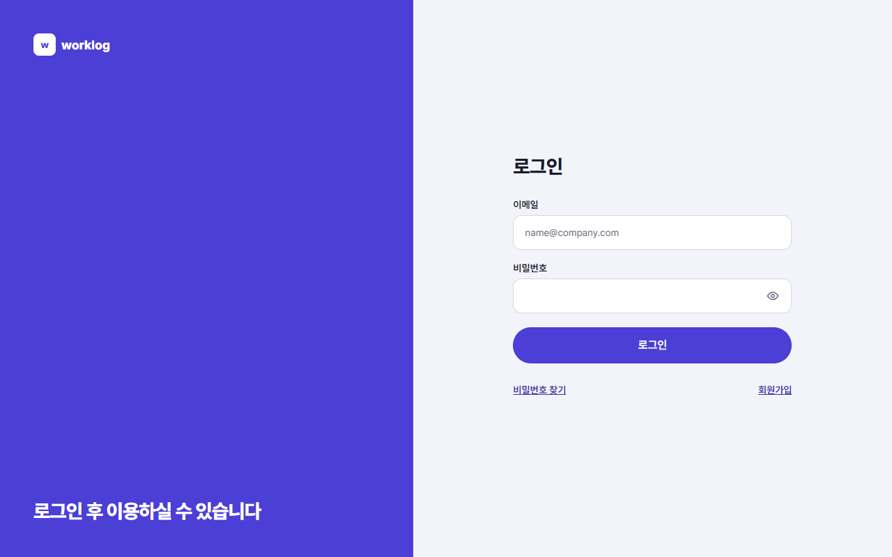
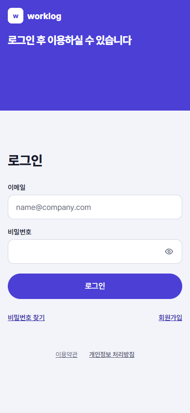

<!-- 담당: WY-ux3. 규칙·화면 목록은 README.md 장 배정 -->
<!-- 근거: AUTH-01~09, UX-08, SCR-AUTH-01·02·03·08, SCR-MOB-02, SCR-SET-06, D-206, D-214·D-215(인증 재촉 안내·프로필 입력 숨김). 화면 문구는 SignupPage·LoginPage·CodeStep·EmailVerificationDialog·InstallGuide·GeneralSettings(InstallAppRow) 코드 기준(feature/records-only 2026-10-12) -->
# 1. 시작하기

이 장을 읽으면 가입하고, 메일로 받은 인증번호를 넣고, 로그인한 뒤 첫 화면에서 무엇을 하면 되는지 알 수 있어요.

## 이 서비스는 무엇인가요

WY Worklog는 개인 업무 기록 도구예요. 계획한 일정이 끝나면 "했나요?"만 확인하고, 그렇게 확인한 것이 그날의 기록으로 쌓여요. 퇴근 전에는 하루 마감으로 하루를 정리해요.

처음 오면 보이는 랜딩 화면에는 **로그인**과 **무료로 시작하기**가 있어요. **무료로 시작하기**를 누르면 가입 화면으로 가요.

## 1. 회원가입

가입에 필요한 것은 이메일, 비밀번호, 그리고 동의 항목이에요. 이름이나 소속은 묻지 않아요.

1. **이메일**에 쓰는 주소를 적어요. 인증번호가 이 주소로 가요.
2. **비밀번호**를 정해요. 칸 아래의 규칙이 지켜지면 ✓로 바뀌어요.
   - 8~64자
   - 영문·숫자 포함
   - 이메일과 다른 문자열
3. **비밀번호 확인**에 같은 비밀번호를 한 번 더 적어요.
4. 동의 항목을 눌러요. **전체 동의**를 누르면 세 개가 한 번에 켜져요.
   - [필수] 만 14세 이상입니다
   - [필수] 이용약관 동의 (내용 보기로 읽어 볼 수 있어요)
   - [필수] 개인정보 수집·이용 동의 (내용 보기로 읽어 볼 수 있어요)
5. **회원가입**을 눌러요.

> 한글 비밀번호는 한 글자가 영문보다 자리를 더 차지해요. 너무 길면 입력하는 동안 바로 알려 줘요.

회원 정보와 이용 기록은 싱가포르에 있는 서버에 보관돼요. 가입 화면 아래에 같은 안내가 있고, **자세히 보기**로 처리방침의 해당 부분을 볼 수 있어요.

### 가입이 안 될 때

- 빠뜨리거나 틀린 칸이 있으면 그 칸 아래에 이유가 보이고, 첫 번째 오류 칸으로 커서가 가요.
- **이미 가입된 이메일입니다**라고 나오면 옆의 **로그인하기**로 가면 돼요.

## 2. 이메일 인증

<!-- D-219(2026-10-13): 이메일 인증 필수. 가입 직후·미인증 로그인 때 인증 화면을 거쳐야 앱을 쓴다. 그림은 재촬영 전이라 없음 -->
가입하면 입력한 이메일로 6자리 인증번호가 가고, 바로 **이메일 인증** 화면이 열려요. 인증을 마쳐야 앱을 쓸 수 있어요.

1. 메일을 열어 6자리 숫자를 확인해요. 메일이 안 보이면 스팸함도 봐요.
2. **이메일 인증** 화면에 6자리를 입력해요.
3. 인증이 끝나면 홈 화면으로 들어가요.

- 인증번호는 10분 동안 쓸 수 있고, 화면에 남은 시간이 보여요.
- 틀리면 "코드가 맞지 않아요(남은 시도 n회)"로 알려 줘요. 5번 틀리거나 10분이 지나면 입력이 잠기고 **새 코드 받기**만 남아요.
- **다시 받기**는 60초 간격으로 눌러야 해요.
- 인증을 마치면 계정 화면에 **인증됨**이 보여요.

인증을 마치기 전에 창을 닫았다면, 다시 로그인할 때 같은 **이메일 인증** 화면이 먼저 열려요.

## 3. 로그인

1. **이메일**과 **비밀번호**를 입력하고 **로그인**을 눌러요.
2. 로그인하면 홈 화면으로 가요. 오래 쓰지 않아 다시 로그인하라는 안내가 뜬 경우에는 보던 화면으로 돌아가요.

- 이메일이나 비밀번호가 틀리면 "이메일 또는 비밀번호가 맞지 않아요"가 보여요.
- 비밀번호를 10번 잘못 입력하면 15분 동안 로그인할 수 없어요. 남은 시간이 화면에 보여요.

### 비밀번호를 잊었어요

1. 로그인 화면의 **비밀번호 찾기**를 눌러요.
2. 가입한 이메일을 적으면 6자리 인증번호가 메일로 가요.
3. 인증번호를 넣고 새 비밀번호를 정해요.
4. 새 비밀번호로 다시 로그인해요.

비밀번호를 바꾸면 이메일 인증도 함께 끝나고, 모든 기기에서 로그아웃돼요.

## 4. 첫 화면

로그인하면 **홈**이 열려요. 아직 업무가 없으면 "오늘 할 일을 한 줄로 적어 보세요"라는 안내와 예시 몇 줄이 보여요.

- 예시를 누르면 입력창에 채워져요.
- 시간·`@프로젝트`·`#태그`·`!우선순위`·`~마감`을 같이 적으면 알아서 나눠 저장해요. 문법은 7장에서 자세히 다뤄요.

화면의 구성(사이드바와 하단 탭)은 2장, 하루를 따라가는 예시는 4장에 있어요.

## 5. 홈 화면에 앱 설치하기

WY Worklog는 휴대폰 홈 화면이나 컴퓨터의 앱으로 설치해서 브라우저 탭 없이 열 수 있어요. 설치하면 알림도 받기 쉬워요.

### 휴대폰

- 설치 안내 카드는 모바일 **홈** 화면 아래에 떠요. 앱을 두 번째로 열 때부터 보여요.
- **Android**: 카드의 **설치**를 누르면 설치 창이 떠요. 브라우저가 설치를 지원할 때만 카드가 나와요.
- **iPhone·iPad (Safari)**: 카드의 안내를 따라 아래 **공유** 버튼을 누르고 **홈 화면에 추가**를 골라요.
- 카드의 ×를 누르면 30일 동안 숨겨져요.

> iPhone에서는 홈 화면에 추가한 앱으로 열어야 푸시 알림을 받을 수 있어요(9장).

### 컴퓨터 (Chrome·Edge)

카드는 나오지 않아요. **설정 › 일반**의 **앱 설치** 줄에서 **WY Worklog 앱 설치**를 눌러요. 브라우저가 설치 창을 줄 수 있을 때만 이 줄이 보여요.

<!-- 촬영 목록: 파일 이름 | 화면 ID | W/M | 찍을 상태
SCR-AUTH-03_W.png | SCR-AUTH-03 | W | 회원가입, 입력 전 (규칙 목록 ○ 상태). 이메일 칸 placeholder 그대로, 실제 주소 입력 금지
SCR-AUTH-08_W.png | SCR-AUTH-08 | W | 인증 창 열린 상태. 위에 표시되는 계정 이메일은 가린다(D-206) 또는 예시 주소 계정으로
SCR-AUTH-02_W.png | SCR-AUTH-02 | W | 로그인, 입력 전
SCR-AUTH-02_M.png | SCR-AUTH-02 | M | 로그인, 입력 전
SCR-MOB-02_M.png | SCR-MOB-02 | M | 모바일 홈 하단의 설치 카드(Android 모양 [설치] 또는 iOS 모양 중 찍을 수 있는 쪽). 두 번째 방문부터 보임 -->
<!-- 자주 묻는 질문 후보: 인증번호 메일이 안 와요(스팸함, 다시 받기 60초 간격) / 인증번호를 5번 틀렸어요(새 코드 받기) / 비밀번호를 10번 틀렸어요(15분) / 인증하지 않으면 무엇이 안 되나요(지금은 없음) / 가입한 이메일을 바꿀 수 있나요(화면에 없음, 확인 필요) -->
