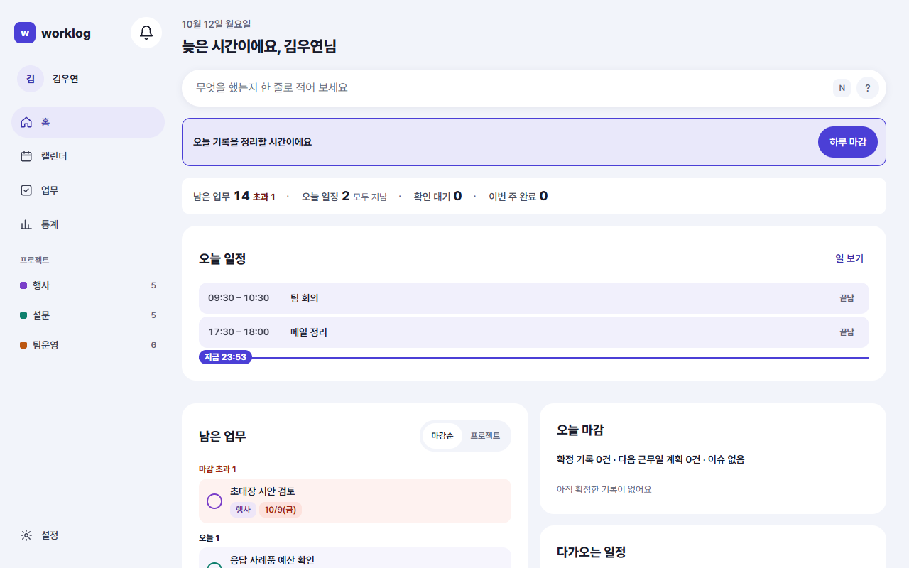
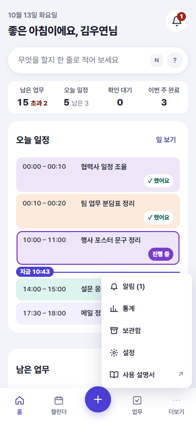
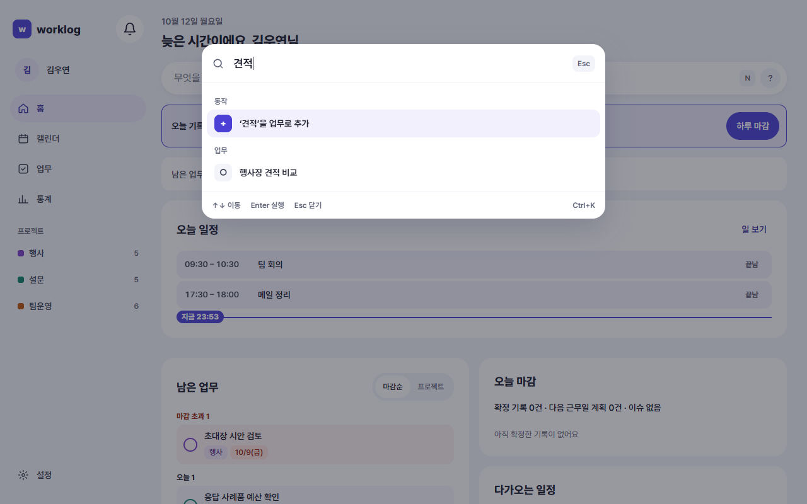

<!-- 담당: WY-planner. 규칙·화면 목록은 README.md 장 배정 -->
<!-- 근거: SCR-COM-01·03·05, P1-10, P1-X-01, P4-03, D-212 Q6, D-214·D-215(일지 메뉴·프로필 탭 숨김, 하단 탭 '일지' 자리에 '업무'), D-224(사이드바·더보기의 사용 설명서), D-226(사이드바 프로젝트 [+]·프로젝트 관리), D-223 ①(뒤로 가기로 시트 닫기, useBackClose). 화면 문구·동작은 AppShell.tsx(MENU·MoreMenu·SidebarProjects, 반응형 AppShell.module.css 1023px·767px)·CommandPalette.tsx·pages/HomePage.tsx 코드 기준(feature/records-only 2026-10-12, main 22e8f34로 2026-10-13 대조) -->
# 2. 화면 구성

이 장을 읽으면 어느 화면에서든 원하는 곳으로 가는 길과, 키보드로 빨리 움직이는 명령 팔레트를 알 수 있어요.

## 큰 화면: 왼쪽 사이드바

컴퓨터처럼 화면이 넓으면 왼쪽에 사이드바가 있어요. 위에서 아래로 이렇게 놓여 있어요.

| 자리 | 하는 일 |
|---|---|
| **worklog** 이름 옆 종 | 알림 센터를 열어요. 안 읽은 알림이 있으면 개수가 보여요(9장) |
| 내 이름 | 누르면 **설정 › 계정**으로 가요 |
| **홈** | 오늘 할 일과 하루 마감이 모인 첫 화면(4장) |
| **캘린더** | 일정을 잡고 옮기는 곳(6장) |
| **업무** | 업무 목록(5장) |
| **통계** | 기간별로 끝낸 일과 기록을 돌아봐요(4장 끝) |
| **프로젝트** 목록 | 프로젝트 이름과 남은 업무 수. 누르면 그 프로젝트의 업무만 거른 업무 목록이 열려요. 제목 옆 **+**로 이름을 적어 바로 만들고, 목록 아래 **프로젝트 관리**로 **설정 › 프로젝트·태그**에 가요(5장) |
| 타이머 | 시간 기록을 켜고 타이머를 돌릴 때만 보여요(8장) |
| **사용 설명서** | 이 설명서를 새 탭으로 열어요 |
| **설정** | 맨 아래에 있어요(9장) |

보관함은 사이드바에 따로 없어요. 업무 목록 맨 아래의 **보관함 ›**으로 들어가요(5장).

화면이 조금 좁으면(태블릿 정도) 사이드바가 아이콘만 남기고 좁아져요. 이름과 프로젝트 목록은 숨겨지고, 아이콘에 마우스를 올리면 이름이 보여요.

## 휴대폰: 아래쪽 탭

휴대폰에서는 사이드바 대신 화면 아래에 탭 다섯 칸이 있어요.

| 탭 | 하는 일 |
|---|---|
| **홈** | 첫 화면 |
| **캘린더** | 처음엔 일 보기로 열려요 |
| 가운데 **+** | **빠른 기록** 시트를 열어요. 한 줄로 업무·일정을 만들고, 남은 확인 대기를 바로 처리해요(4장) |
| **업무** | 업무 목록 |
| **더보기** | **알림 · 통계 · 보관함 · 설정 · 사용 설명서**(사용 설명서는 새 탭) |

- 알림 종은 휴대폰에서는 **홈** 화면 머리 오른쪽에 있어요. 다른 화면에서는 **더보기 › 알림**으로 가요.
- 빠른 기록 시트, 필터 시트처럼 아래에서 올라오는 창과 더보기 메뉴는 휴대폰의 **뒤로 가기**로도 닫혀요.
- 타이머를 돌리는 중이면 탭 바로 위에 작은 플레이어가 떠요(8장).

## 어느 화면에서든 쓰는 단축키

| 키 | 하는 일 |
|---|---|
| **Ctrl+K** (Mac은 **⌘K**) | 명령 팔레트를 열고 닫아요 |
| **N** | 빠른 입력창으로 가요. 지금 화면에 입력창이 없으면 홈의 입력창으로 가요 |

한 글자 단축키(N, 캘린더의 D·W·M 등)는 글자를 입력하는 칸에 있을 때는 동작하지 않아요. **설정 › 일반**에서 끌 수 있어요(9장).

## 명령 팔레트

**Ctrl+K**를 누르면 화면 가운데에 검색창 하나가 떠요. 마우스로 메뉴를 찾아가지 않고, 이름을 몇 글자 적어 바로 실행해요. 키보드로 여는 기능이라 휴대폰에서는 쓰지 않아요.

아무것도 적지 않으면 전체 목록이 보여요. **최근 사용**한 명령이 맨 위에 와요.

| 묶음 | 명령 |
|---|---|
| 동작 | 업무 추가 · 일정 추가 · 하루 마감 · 빠른 마감 (시간 기록을 켜면 타이머 시작·타이머 정지도) |
| 이동 | 홈 · 캘린더 · 업무 목록 · 통계 · 설정 · 기록 옵션 |

적은 글자에 따라 이런 것도 나와요.

- **업무 찾기**: 업무 제목 일부를 적으면 맞는 업무가 **업무** 묶음에 나와요. 고르면 그 업무의 상세가 열려요. 제목이 정확히 같은 업무가 있으면 맨 앞에 와요.
- **업무로 추가**: 맞는 명령이 없으면 "‘적은 글’을 업무로 추가"가 맨 앞에 나와요. 고르면 홈의 빠른 입력창에 그 글이 채워지고, Enter를 누르면 업무가 만들어져요.
- **날짜로 가기**: `내일`, `10/12`, `다음주 수요일`처럼 날짜만 적으면 "그날 캘린더 보기"가 나와요.

↑↓로 고르고 **Enter**로 실행, **Esc**로 닫아요.

> 예: Ctrl+K → `견적` → "행사장 견적 비교" 업무가 보여요. Enter를 누르면 그 업무의 상세가 열려요.

### 하루 마감과 빠른 마감

- **하루 마감**은 홈의 하루 마감 띠와 같은 창을 열어요(4장).
- **빠른 마감**은 단계를 건너뛰고 바로 마감해요. 확인 대기는 그대로 두고, 넘길 업무는 처음 골라진 대로 모두 넘기고, 이슈는 비워 둬요. 잘못 마감했으면 마감 뒤 창의 **마감 취소**로 되돌려요.

<!-- 촬영 목록: 파일 이름 | 화면 ID | W/M | 찍을 상태
SCR-COM-01_W.png | SCR-COM-01 | W | 홈(1280px). 사이드바에 이름 '김우연'·메뉴 4개·프로젝트 3개(행사·설문·팀운영, 남은 업무 수)와 제목 옆 +·프로젝트 관리·사용 설명서·설정이 보이게. 타이머는 끈 상태
SCR-COM-01_M.png | SCR-COM-01 | M | 홈(390px). 하단 탭 다섯 칸과 더보기 메뉴를 연 상태(알림·통계·보관함·설정·사용 설명서). 다시 찍기는 다음 촬영 때(D-224)
SCR-COM-03_W.png | SCR-COM-03 | W | 명령 팔레트에 '견적'을 적은 상태(업무 묶음에 '행사장 견적 비교'). 또는 빈 상태로 동작·이동 묶음이 보이게 -->
<!-- 자주 묻는 질문 후보: 보관함은 어디 있나요(업무 목록 맨 아래 / 모바일 더보기) / 휴대폰에서 명령 팔레트를 열 수 있나요(키보드 기능이라 없음, 대신 + 빠른 기록) / 업무일지 메뉴가 없어요(지금은 업무 기록 도구만 제공) -->
