<!-- 담당: WY-planner (확인 대기·하루 마감 부분은 WY-ux2 검토). 규칙·화면 목록은 README.md 장 배정 -->
<!-- 근거: REC-01·02·03·04, SCH-04·07, LOG-13·14, HOME-01~, SCR-HOME-01·02, SCR-COM-02, SCR-CAL-02·06·09, SCR-TASK-03, SCR-REC-01, SCR-MOB-01, SCR-LOG-03, SCR-STAT-01, D-39·D-98·D-100·D-107·D-212(Q2·Q3·Q4)·D-214·D-215. 화면 문구·동작은 feature/records-only 코드 기준(2026-10-12): pages/HomePage·home/HomeDashboard·TodayTimeline·CloseBand·closeBandState, logs/HomeLogCards·DayClose, records/PendingPanel·RecordDialog, tasks/CompletionResult, components/QuickSheet, calendar/TaskPanel·DayRecords, stats/StatsPage, 백엔드 DailyCloseService.carryOvers·LogBuilder.planTitle -->
# 4. 하루 따라 하기

이 장을 읽으면 아침에 할 일을 적는 것부터 저녁에 하루를 마감하는 것까지, 하루 동안 앱을 쓰는 순서를 따라 할 수 있어요.

가나다상사 마케팅팀 김우연 대리의 화요일을 따라가요. 근무 시간은 9시부터 18시, 하루 마감 시각은 기본값 18:00이에요. 시간 기록 옵션은 꺼 둔 상태예요(켠 하루는 이 장 끝과 8장).

| 시각 | 하는 일 | 쓰는 화면 |
|---|---|---|
| 09:00 | 오늘 볼 것 확인, 할 일 적기 | 홈 |
| 09:20 | 오늘 시간표 짜기 | 캘린더 |
| 낮 | 끝낸 업무 완료, 계획에 없던 일 기록 | 업무·캘린더·휴대폰 |
| 일정이 끝날 때마다 | 확인 대기 처리 | 홈 |
| 18:00 | 하루 마감 | 홈 |
| 금요일 오후 | 한 주 돌아보기 | 통계 |

## 1. 아침: 홈에서 오늘 보기

로그인하면 **홈**이 열려요. 맨 위에 날짜와 인사, 그 아래 큰 입력창이 있어요.

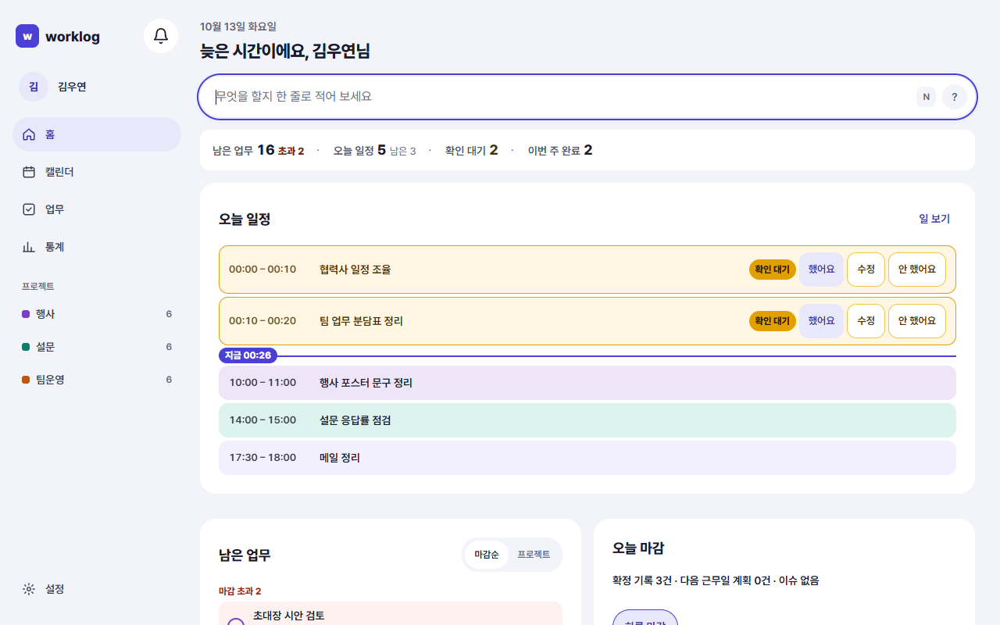

위에서 아래로 이렇게 놓여 있어요.

| 자리 | 보이는 것 |
|---|---|
| 빠른 입력창 | "무엇을 할지 한 줄로 적어 보세요". 하루 마감 시각이 지나면 "무엇을 했는지 한 줄로 적어 보세요"로 바뀌어요 |
| 요약 한 줄 | **남은 업무**(마감 지난 것은 '초과 n') · **오늘 일정**(남은 n) · **확인 대기** · **이번 주 완료**. 누르면 그 목록으로 가요 |
| 오늘 일정 | 오늘 잡힌 일정이 시간순으로. 지금 하는 일정에는 '진행 중'이 붙어요 |
| 남은 업무 | 마감순 또는 프로젝트로 묶어 10개까지. 동그란 체크로 바로 완료해요 |
| 오른쪽 열 | **오늘 마감** 카드 · **다가오는 일정**(내일부터 7일) · **이번 주 마감**(요일마다 마감함·마감 전) |

휴대폰에서는 같은 내용이 한 줄로 이어져요.

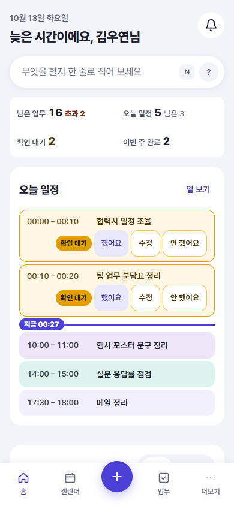

> 요약 줄의 **확인 대기**에 숫자가 있으면, 어제까지 끝난 일정 중 아직 확인하지 않은 것이 있다는 뜻이에요. 먼저 눌러서 정리해요(아래 4절).

### 오늘 할 일 적기

빠른 입력창에 한 줄씩 적고 Enter를 눌러요(문법은 7장).

```
주간 보고 정리 @팀운영 #보고 ~금
14-16 행사장 견적 비교 @행사 #예산
```

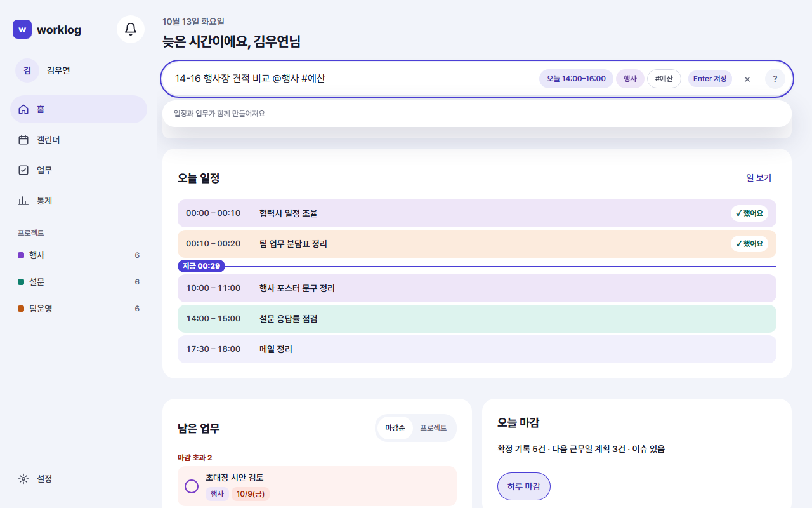

- 첫 줄은 시간이 없어서 **업무**만 생겨요. 마감은 이번 주 금요일이에요.
- 둘째 줄은 시간이 있어서 **업무와 오늘 14:00–16:00 일정**이 함께 생기고 서로 연결돼요.

적는 동안 입력창 아래에 "업무가 만들어져요" 또는 "일정과 업무가 함께 만들어져요"가 보여서, 무엇이 생길지 미리 알 수 있어요.

## 2. 계획: 캘린더에서 시간표 짜기

사이드바의 **캘린더**를 열고 **일** 보기(단축키 D)로 오늘을 봐요. 오른쪽에 **업무 패널**(맨 위 이름 '할 일 상자', 3장)이 있어요. 아직 일정을 잡지 않은 업무가 마감이 가까운 순서로 보여요.

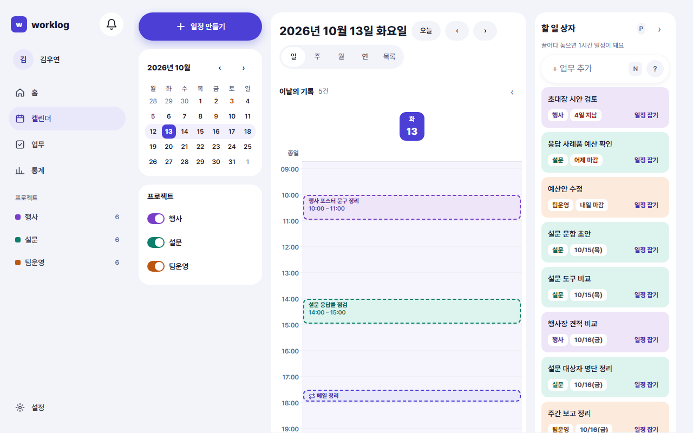

1. 업무 패널의 "초대장 시안 검토"를 끌어서 10시 줄에 놓아요. 10:00–11:00에 그 업무가 연결된 일정이 생겨요.
2. 16시 빈 칸을 눌러 빠른 만들기 창을 열고 `외부 협력사 미팅`이라고 적은 뒤 **저장**을 눌러요. 업무가 없는 일정이에요.

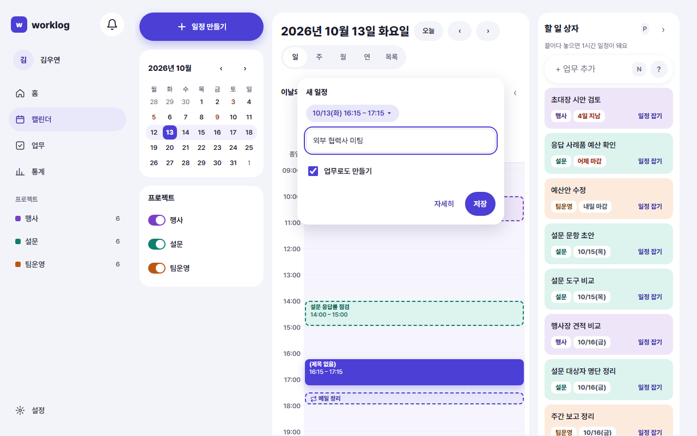

반복 일정 "매일 17:30 메일 정리"는 미리 만들어 두었어요(반복 만들기는 6장).

이제 오늘 시간표는 이래요.

| 시간 | 일정 | 연결 업무 | 끝나면 확인 대기가 생기나요 |
|---|---|---|---|
| 10:00–11:00 | 초대장 시안 검토 | 있음 | 생겨요 |
| 14:00–16:00 | 행사장 견적 비교 | 있음 | 생겨요 |
| 16:00–17:00 | 외부 협력사 미팅 | 없음 | 안 생겨요 |
| 17:30–18:00 | 메일 정리(매일 반복) | 있음 | 생겨요 |

> 일정은 계획이에요. 일정을 잡았다고 업무가 진행 중이나 완료로 바뀌지는 않아요.

## 3. 일하는 중: 완료하고 기록하기

### 업무를 끝냈을 때

어제부터 하던 "설문 문항 초안"을 끝냈어요. 홈이나 업무 목록에서 그 업무의 동그란 체크를 눌러요.

화면 아래에 **결과 한 줄** 창이 떠요.

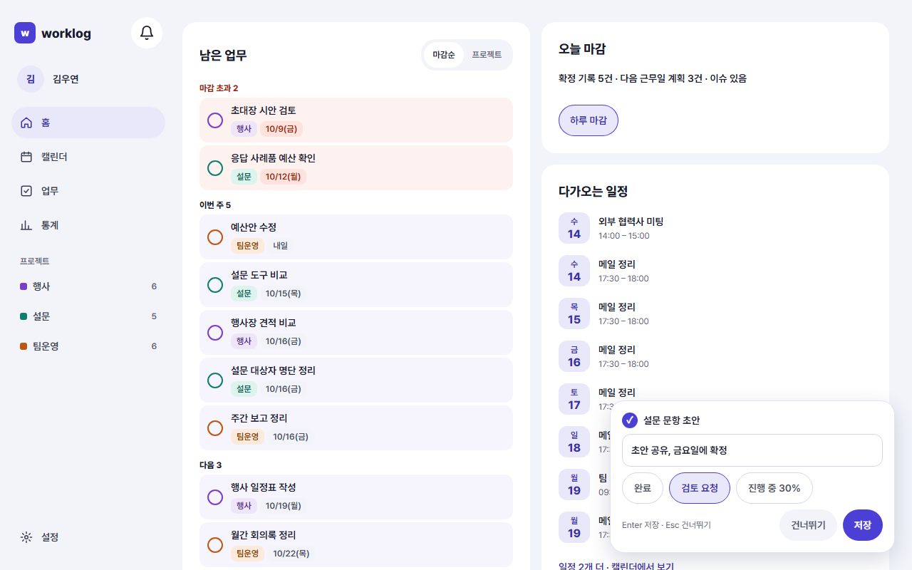

1. 결과를 한 줄 적어요. 예: `초안 공유, 금요일에 확정`
2. 칩을 골라요: **완료** · **검토 요청** · **진행 중**(진행 중을 고르면 진행률도 골라요). 이번엔 **검토 요청**.
3. **저장**(Enter)을 눌러요.

결과를 적기 귀찮으면 **건너뛰기**(Esc)를 눌러요. 결과 없이 '완료' 기록이 남아요. 업무를 완료하면 어느 쪽이든 오늘 기록이 하나 생겨요.

### 계획에 없던 일을 했을 때

오전에 협력사에서 전화가 와서 30분 동안 일정 조정을 했어요. 일정에 없던 일이라 확인 대기가 생기지 않아요. 직접 기록을 남겨요.

1. 캘린더 일 보기 오른쪽 **이날의 기록**에서 **기록 추가**를 눌러요.
2. **한 일**에 `협력사 일정 조정 통화`를 적어요.
3. 필요하면 업무를 연결하고, **결과 한 줄**과 칩을 골라요. 칩은 **없음** · **완료** · **검토 요청** · **진행 중**이에요. 결과를 정할 게 없으면 **없음**으로 둬요.
4. **날짜**가 오늘인지 보고 **저장**을 눌러요. "기록을 남겼어요"가 떠요.

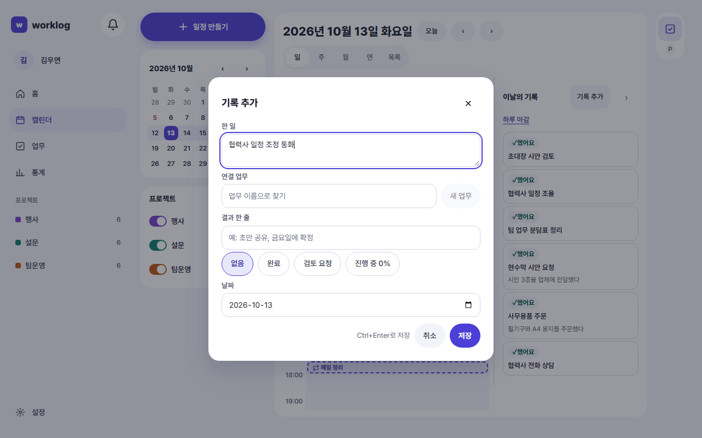

직접 남긴 기록은 처음부터 '했어요' 기록이에요. 확인할 필요가 없어요.

### 휴대폰에서

밖에 있을 때는 하단 탭 가운데 **+**를 눌러 **빠른 기록** 시트를 열어요.

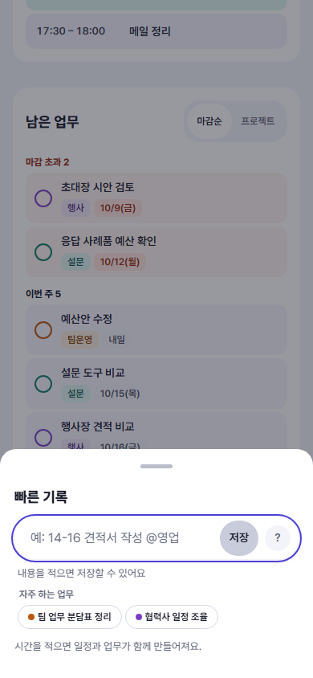

- **한 줄 입력**에 홈과 같은 문법으로 적고 **저장**을 눌러요.
- 확인 대기가 있으면 시트 안에 첫 건이 보여요. **했어요**로 바로 처리하거나, **n건 더 보기**로 전체 목록을 열어요.

## 4. 일정이 끝나면: 확인 대기 처리

10:00–11:00 "초대장 시안 검토" 일정이 끝나면, 앱이 "이 일을 했나요?" 하고 **확인 대기**를 만들어 둬요(3장). 아직 기록은 아니에요.

홈의 **오늘 일정**에서 끝난 일정 옆에 '확인 대기'와 버튼 세 개가 보여요. 끝난 직후 잠깐은 '끝남'으로 보이다가 확인 대기로 바뀌어요.

| 버튼 | 이럴 때 | 결과 |
|---|---|---|
| **했어요** | 계획대로 했어요 | 계획한 시각대로 기록이 돼요 |
| **수정** | 하긴 했는데 내용이나 시간이 달랐어요 | "확인 대기 수정" 창에서 고쳐 저장하면 '했어요' 기록이 돼요 |
| **안 했어요** | 못 했어요 | '안 했어요'로 표시돼요. 실적에는 들어가지 않아요 |

확인 대기가 여러 건이면 요약 줄의 **확인 대기**를 눌러 한 창에서 처리해요.

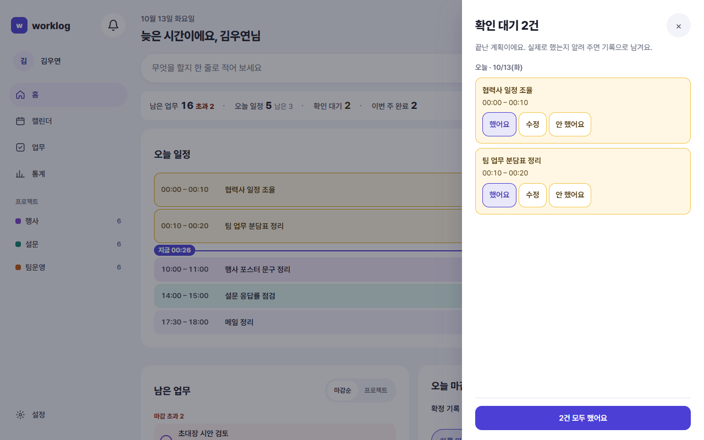

- 창 제목은 "확인 대기 n건"이고, 날짜별(오늘·어제…)로 묶여 있어요.
- 항목마다 **했어요 · 수정 · 안 했어요**, 아래에는 한꺼번에 처리하는 **n건 모두 했어요**가 있어요.
- 처리하면 화면 아래에 "1건을 했어요로 기록했어요" 같은 알림과 **되돌리기**가 잠깐 떠요.
- 다 처리하면 창이 저절로 닫혀요.

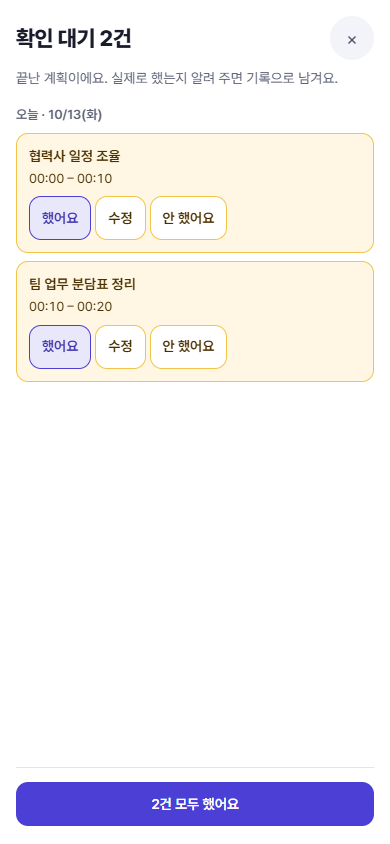

> 14:00–16:00 견적 비교는 했지만 업체를 하나로 정하지는 못했어요. 이럴 땐 **수정**을 눌러 **결과 한 줄**에 `두 곳으로 좁힘`을 적고 칩을 **진행 중**으로 골라 저장해요. 시간까지 고치는 칸은 시간 기록 옵션을 켰을 때만 보여요(8장).

- 홈에는 오늘을 포함한 **최근 7일**의 확인 대기만 보여요. 더 지난 것은 캘린더 일 보기에서 그날을 열어 처리해요.
- 지금 진행 중인 일정의 확인 대기는 일정이 끝난 뒤에 나타나요.

## 5. 18:00: 하루 마감

하루 마감 시각(18:00)이 되면 홈 맨 위에 띠가 떠요.

> **오늘 기록을 정리할 시간이에요** · 확인 대기 n건 · [하루 마감]

**하루 마감**을 누르면 창이 열려요. 다른 길도 있어요.

- 하루 마감 알림을 켜 두었다면(9장) 알림을 눌러도 돼요. 알림 센터에서 누르든 휴대폰·PC 푸시를 누르든, 홈으로 가서 그날의 하루 마감 창이 열려요.
- 18시 전에는 오른쪽 **오늘 마감** 카드의 **하루 마감** 버튼으로 열어요.
- 명령 팔레트(Ctrl+K)의 **하루 마감**(2장). 같은 곳의 **빠른 마감**은 단계를 건너뛰고 바로 마감해요(확인 대기는 그대로 두고, 넘길 업무는 처음 골라진 대로, 이슈는 비운 채).

창은 세 단계예요. 제목에 "하루 마감 1/3"처럼 단계가 보여요. 확인 대기가 없으면 1단계를 건너뛰고 두 단계가 돼요.

### 1단계: 확인 대기

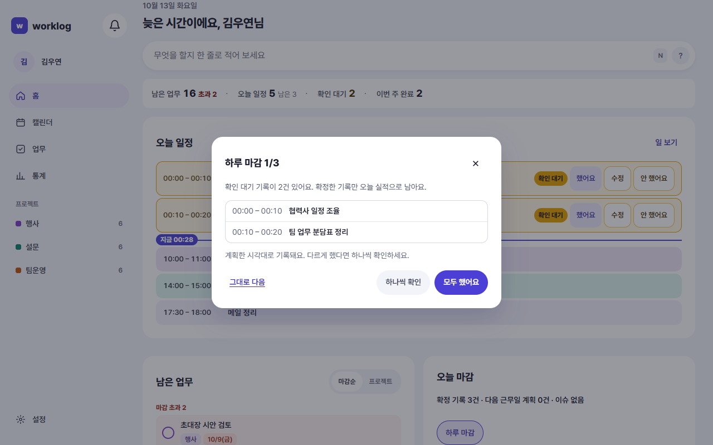

"확인 대기 기록이 n건 있어요. 확정한 기록만 오늘 실적으로 남아요."라는 안내와 남은 확인 대기 이름이 5개까지 보여요(더 있으면 "외 n건"). 목록 아래에는 "계획한 시각대로 기록돼요. 다르게 했다면 하나씩 확인하세요."라는 줄이 있어요. 마감하는 날까지의 확인 대기만 나와요. 오늘을 마감하면 오늘과 그 전 **최근 7일** 것이고, 다른 날 것에는 날짜가 붙어요. 지난 날을 마감할 때는 그날까지의 것만 나와서, 그 뒤 날짜의 기록은 확정되지 않아요.

| 버튼 | 하는 일 |
|---|---|
| **모두 했어요** | 위에 나온 확인 대기를 계획한 시각대로 모두 '했어요'로 기록하고 다음 단계로 가요. 5초 동안 되돌릴 수 있어요(그 안에 마감까지 하면 되돌리기는 사라지고, 마감 취소로 돌려요) |
| **하나씩 확인** | 4절의 확인 대기 창을 열어 하나씩 처리해요. 다 처리하면 다음 단계로 가요 |
| **그대로 다음** | 처리하지 않고 넘어가요. 남은 건 확인 대기로 그대로 남고, 오늘 실적에 들어가지 않아요 |

### 2단계: 다음 근무일 계획

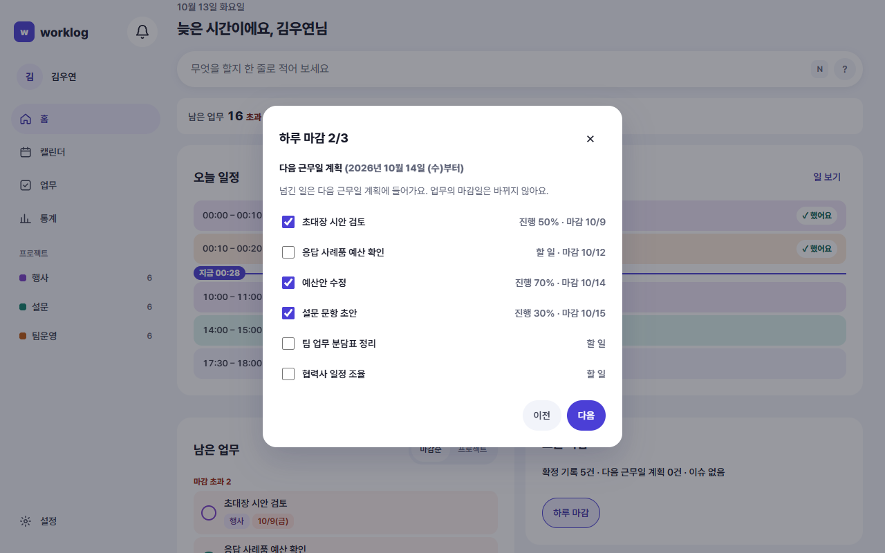

다음 근무일로 넘길 업무를 골라요. 처음엔 모두 골라져 있으니, 넘기지 않을 것만 체크를 풀어요.

- 목록에 나오는 업무: 아직 끝내지 않은 업무(할 일·진행 중) 가운데 오늘 기록이 있거나, 마감이 다음 근무일까지이거나, 진행 중인 업무예요. 보류한 업무는 나오지 않아요.
- 줄마다 상태(할 일 / 진행 n%)와 마감일이 보여요.
- 넘겨도 업무의 상태와 마감일은 바뀌지 않아요.
- 금요일처럼 다음 근무일이 다음 주이면 단계 이름이 **다음 주 계획**이 돼요.
- 넘길 업무가 없으면 "넘길 업무가 없어요"가 보여요.

**다음**을 눌러요. 앞 단계로 돌아가려면 **이전**(확인 대기가 없어 1단계를 건너뛰었으면 이 단계에는 **이전**이 없어요).

### 3단계: 이슈 및 특이사항

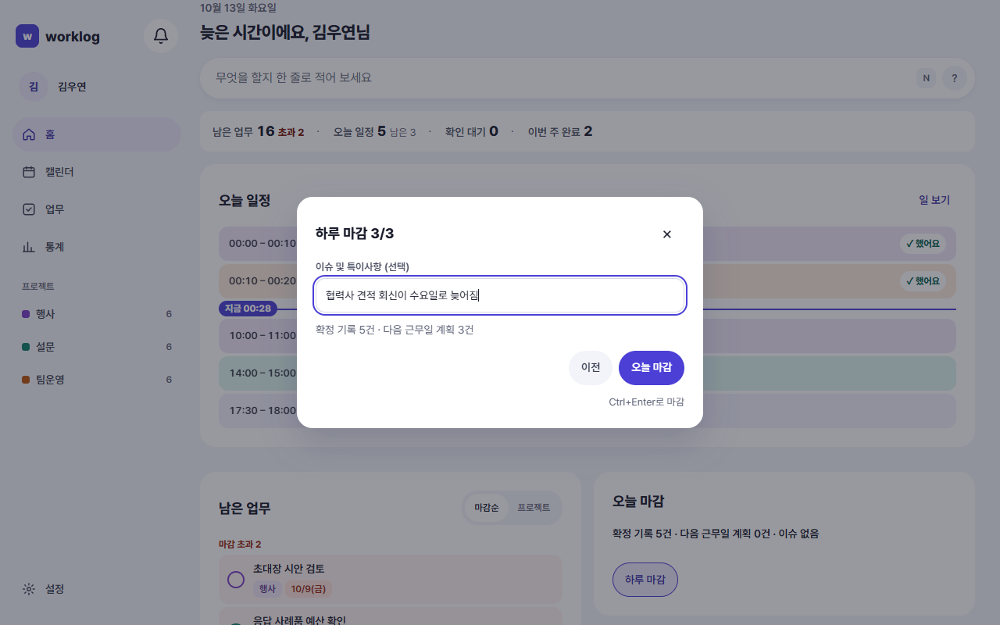

1. 오늘 남길 이슈가 있으면 한 줄 적어요. 비워도 돼요. 예: `협력사 견적 회신이 수요일로 늦어짐`
2. 아래 요약 "확정 기록 n건 · 다음 근무일 계획 n건"을 확인해요.
3. **오늘 마감**을 눌러요(Ctrl+Enter, Mac은 ⌘Enter). 지난 날을 마감할 때는 버튼 이름이 **마감**이에요.

### 마감한 뒤

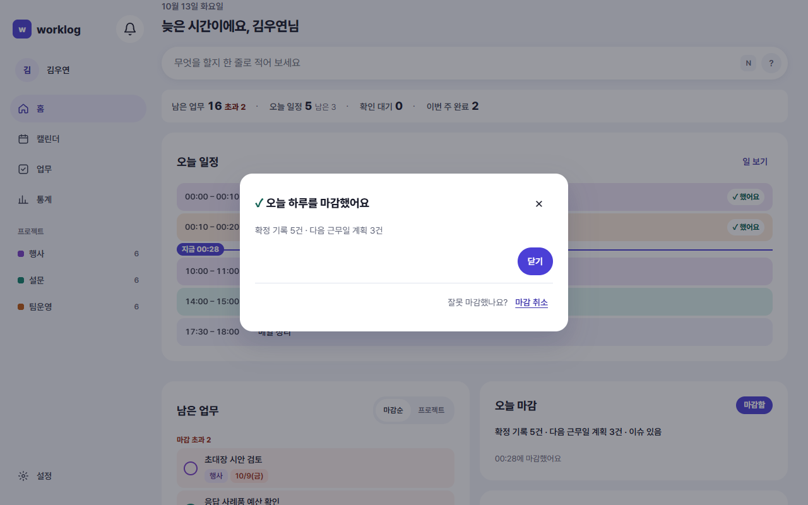

- 창에 "✓ 오늘 하루를 마감했어요"와 요약이 보여요. **닫기**를 눌러요.
- 홈의 띠가 "✓ 오늘 하루를 마감했어요 · 18:05 마감 · 다음 근무일 계획 3건"처럼 바뀌고, **오늘 마감** 카드에 '마감함'이 붙어요.
- 잘못 마감했으면 창 아래 **잘못 마감했나요? 마감 취소**를 눌러요. "마감을 취소할까요? 넘긴 계획은 그대로예요."에서 **마감 취소**를 고르면 마감 전으로 돌아가고, **다시 마감**으로 처음부터 다시 할 수 있어요.

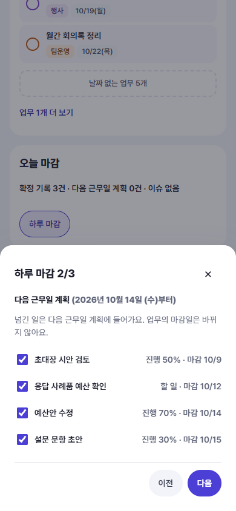

> 넘긴 계획을 나중에 다시 보거나 고치는 화면은 아직 없어요. 넘기기 전에 2단계에서 골라 주세요.

### 이럴 땐 이렇게

- **마감을 깜빡했어요**: 캘린더 일 보기에서 그날을 열고 **이날의 기록**의 **하루 마감**을 눌러요. 지난 날도 마감할 수 있어요(이 버튼은 오늘과 지난 날에만 있어요).
- **이미 마감한 날을 다시 열었어요**: "오늘은 이미 마감했어요"(지난 날이면 "10월 6일은 …")가 보여요. 바꾸려면 같은 창의 **마감 취소**를 누른 뒤 다시 마감해요.
- **근무일이 아닌 날**: 주말에 일했다면 그날도 마감할 수 있어요. 홈의 마감 띠는 그날 기록이 있을 때만 떠요. 넘긴 업무는 다음 근무일로 가요.

## 6. 돌아보기

### 그날의 기록

캘린더 **일** 보기 오른쪽 **이날의 기록**에 그날 남긴 기록이 모여요. 일정에서 온 기록은 "계획 14:00–16:00"처럼 계획 시간이 함께 보이고, 누르면 고칠 수 있어요. 접어 두면 "3건 · 대기 1 · 마감함"처럼 요약만 보여요.

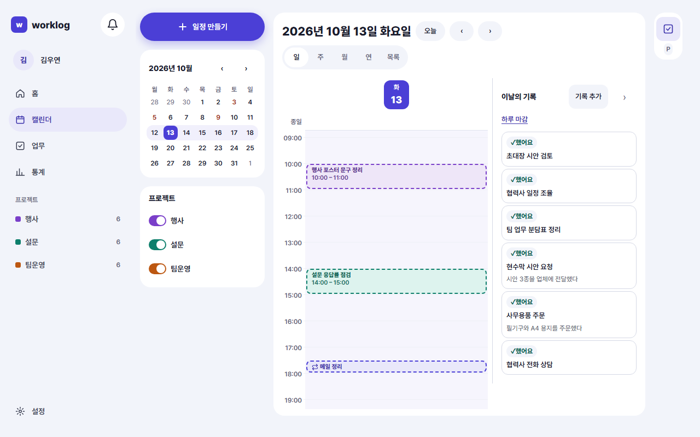

한 업무에 쌓인 기록은 업무 상세의 **기록 이력**에서 봐요(5장).

### 통계

사이드바의 **통계**(휴대폰은 더보기 › 통계)에서 기간을 골라 돌아봐요.

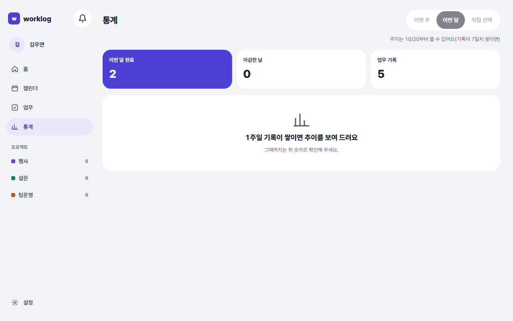

- 기간: **이번 주 · 이번 달 · 직접 선택**.
- 맨 위 요약: **이번 주 완료**(고른 기간에 끝낸 업무 수. 기간에 따라 '이번 달 완료'·'기간 안 완료') · **마감한 날**(하루 마감을 한 날 수) · **업무 기록**(기록 수).
- 그 아래 주별(또는 달별) 완료 업무 그래프와 **프로젝트별 완료**.
- 추이 그래프와 기간 고르기는 첫 기록을 남기고 7일이 지나야 쓸 수 있어요. 그 전에는 위 숫자로 봐요.
- 시간 기록을 켜면 소요시간 비중과 '주간 회고 · 예상 대비 실제'가 더 보여요(8장).

## 7. (옵션) 시간 기록을 켠 하루

**설정 › 기록 옵션**에서 시간 기록을 켜면 같은 하루가 조금 달라져요. 자세한 것은 8장이에요.

- 업무를 시작할 때 **▶**로 타이머를 켜고, 끝나면 **정지**해요. 잰 시간이 기록이 돼요.
- 일정에서 타이머를 켜면 그 일정의 확인 대기는 따로 생기지 않아요.
- 홈의 오늘 일정이 **계획**과 **실제** 두 열로 바뀌고, 기록이 없는 시간은 점선 **빈 시간**으로 보여요. 눌러서 한 번에 채워요.

<!-- 촬영 목록: 파일 이름 | 화면 ID | W/M | 찍을 상태
SCR-HOME-01_W.png | SCR-HOME-01 | W | 화요일 오전, 마감 시각 전. 요약 줄(남은 업무·오늘 일정·확인 대기 2·이번 주 완료), 오늘 일정 4개, 남은 업무, 오른쪽 열 3카드
SCR-HOME-01_M.png | SCR-HOME-01 | M | 같은 상태 390px, 머리 오른쪽 종 보임
SCR-COM-02_W.png | SCR-COM-02 | W | 홈 입력창에 `14-16 행사장 견적 비교 @행사 #예산` 입력 중, 칩과 "일정과 업무가 함께 만들어져요" (07장 그림과 겹치면 하나만 찍고 같이 씀)
SCR-CAL-09_W.png | SCR-CAL-09 | W | 일 보기 + 업무 패널, '초대장 시안 검토'를 10시로 끄는 중 또는 놓은 직후
SCR-CAL-06_W.png | SCR-CAL-06 | W | 16시 빈 칸을 눌러 연 빠른 만들기 창, '외부 협력사 미팅' 입력
SCR-TASK-03_W.png | SCR-TASK-03 | W | '설문 문항 초안' 완료 직후 결과 한 줄 창, 결과 입력·검토 요청 칩 선택
SCR-REC-01_W.png | SCR-REC-01 | W | 기록 추가 창, 한 일 '협력사 일정 조정 통화' 입력(시간 기록 꺼짐 — 시간 칸 없음)
SCR-MOB-01_M.png | SCR-MOB-01 | M | 빠른 기록 시트, 확인 대기 첫 건과 'n건 더 보기' 보임
SCR-HOME-02_W.png | SCR-HOME-02 | W | 확인 대기 패널, 오늘·어제 묶음에 3건, 'n건 모두 했어요' 보임
SCR-HOME-02_M.png | SCR-HOME-02 | M | 같은 패널 390px
SCR-LOG-03_W_1.png | SCR-LOG-03 | W | 하루 마감 1/3, 확인 대기 2~3건 이름, 모두 했어요·하나씩 확인·그대로 다음
SCR-LOG-03_W_2.png | SCR-LOG-03 | W | 2/3 다음 근무일 계획, 업무 3~4개(할 일·진행 n%·마감일), 체크 하나는 푼 상태
SCR-LOG-03_W_3.png | SCR-LOG-03 | W | 3/3 이슈 한 줄 입력, 요약 줄, 오늘 마감 버튼
SCR-LOG-03_W_완료.png | SCR-LOG-03 | W | 완료 창: ✓ 오늘 하루를 마감했어요, 요약, 닫기, 마감 취소 줄
SCR-LOG-03_M.png | SCR-LOG-03 | M | 2/3 단계 390px(단계별 모바일 한 장)
SCR-CAL-02_W.png | SCR-CAL-02 | W | 마감한 날의 일 보기 + 이날의 기록(했어요·확인 대기·계획 시간 보임) (06장 그림과 겹치면 하나만)
SCR-STAT-01_W.png | SCR-STAT-01 | W | 이번 주(또는 이번 달), 2주 데이터 쌓인 뒤. 요약 3칸·주별 완료 그래프·프로젝트별 완료 -->
<!-- 데이터 메모(WY-qa): 촬영하는 날 업무 패널에 '초대장 시안 검토'가 일정 없이 남아 있어야 하고, 확인 대기는 어제 것 1건 + 오늘 것 1~2건이 좋다. 시간 기록 옵션 꺼짐 -->
<!-- 확인 필요(WY-qa 대조): ② 빠른 기록 시트에서 확인 대기 첫 건 처리 문구 -->
<!-- 자주 묻는 질문 후보: 일정을 잡았는데 업무가 완료되지 않아요 / 확인 대기가 안 떠요(업무 연결 여부, 일정이 끝났는지, 7일) / 하루 마감을 안 하면 어떻게 되나요(기록은 그대로, 마감한 날 수에 안 셈) / 넘긴 계획은 어디서 보나요(아직 화면 없음) / 마감을 취소했더니 넘긴 계획은요(그대로) -->
