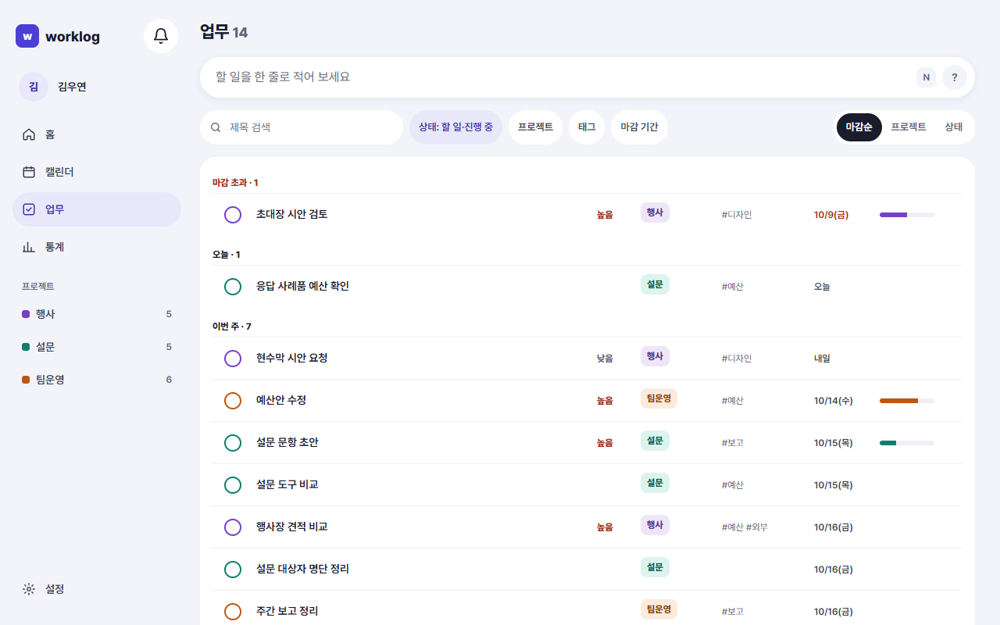
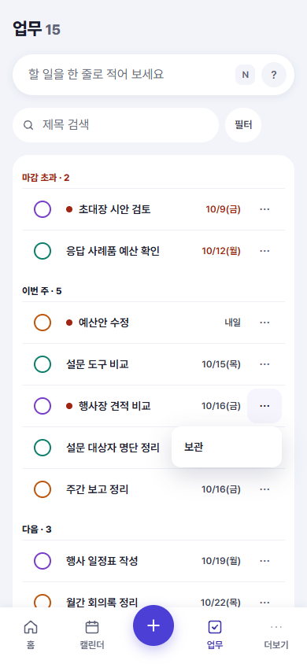
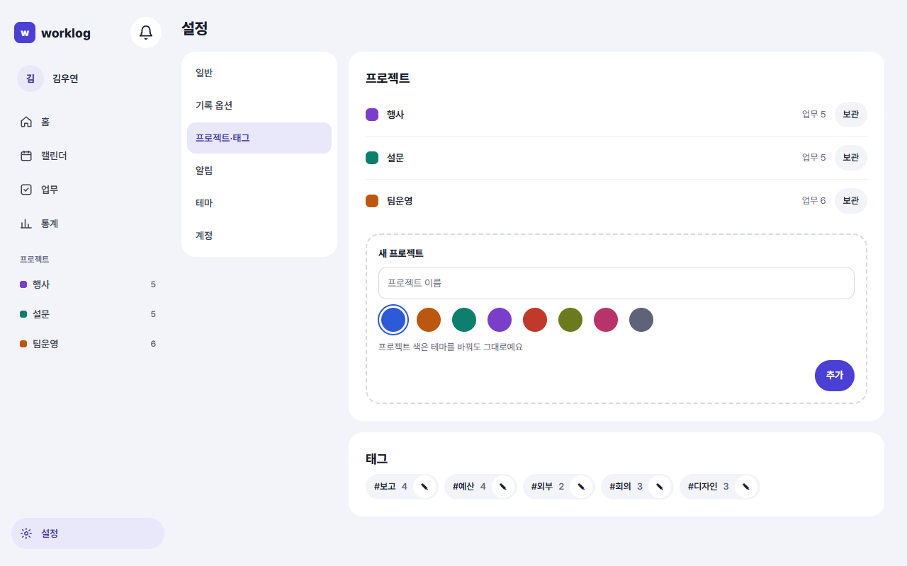
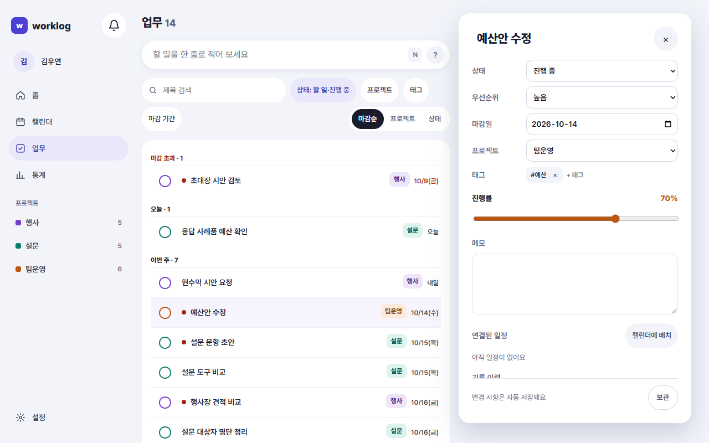
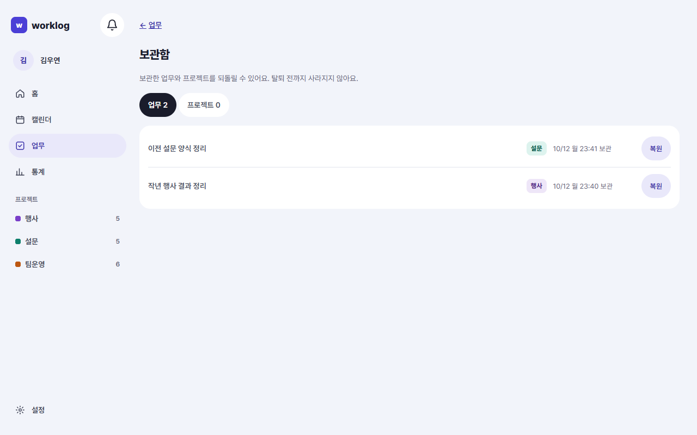

<!-- 담당: WY-ux2. 규칙·화면 목록은 README.md 장 배정 -->
<!-- 근거: 요구사항정의서 v2.4 TASK-01~05·08, REC-02, SCH-04, 화면 SCR-TASK-01·02·03·04, SCR-SET-08, SCR-COM-01, 결정 D-59·D-68·D-103·D-214. 화면 문구는 frontend/src/tasks(TaskListPage·TaskDetailPanel·view·CompletionResult), archive/ArchivePage, settings/ProjectSettings 코드 기준 -->
<!-- 초안 2026-10-12 (WY-ux2). 용어 정의는 03-용어.md 표를 그대로 씀. 가상 데이터는 README '가상 데이터' -->
# 5. 업무 다루기

이 장을 읽으면 업무를 만들고, 훑어보고, 고치고, 치우는 방법을 알 수 있어요.

## 업무 목록 한눈에

사이드바(모바일은 하단 탭)의 **업무**를 누르면 업무 목록이 열려요. 앞으로 해야 할 일이 마감이 가까운 순서로 모여 있어요.



위에서 아래로 이렇게 이어져요.

1. **입력창** — 한 줄로 적고 Enter를 누르면 업무가 만들어져요(적는 법은 7장).
2. **검색·필터·묶기** — 제목 검색, 상태·프로젝트·태그·마감 기간 필터, 마감순·프로젝트·상태 묶기.
3. **목록** — 업무 한 줄이 하나의 업무예요.

처음 열면 **할 일**과 **진행 중** 업무만 보여요. **완료**한 업무는 목록 맨 아래의 "완료 n개 (최근 7일) 펼치기"에, **보류**한 업무는 상태 필터에서 '보류'를 켜야 보여요.

### 한 줄에 보이는 것

| 칸 | 뜻 |
|---|---|
| 동그란 체크 | 누르면 업무를 완료해요 |
| 제목 | 누르면 업무 상세가 열려요 |
| 우선순위 | '높음'과 '낮음'만 적혀요. '보통'은 비워 둬서 눈에 띄는 것만 보여요 |
| 프로젝트 | 프로젝트 이름 칩(프로젝트마다 색이 달라요) |
| 태그 | #보고 #회의처럼 이어서 적혀요 |
| 마감 | 오늘·내일 또는 날짜. 마감이 지났으면 붉은 글씨예요 |
| 진행률 | 막대로 보여요. 0%면 비워 둬요 |
| ◷ | 이 업무가 캘린더 일정에 놓여 있어요 |

화면이 좁으면(태블릿·모바일) 체크·제목·프로젝트·마감만 남아요. 우선순위가 '높음'이면 제목 앞에 작은 점이 붙어 알려 줘요.



### 묶어 보기

목록 위의 **마감순 · 프로젝트 · 상태** 버튼으로 묶는 기준을 바꿔요.

| 묶기 | 이렇게 나뉘어요 |
|---|---|
| 마감순 | 마감 초과 → 오늘 → 이번 주 → 다음 → 날짜 없음 |
| 프로젝트 | 프로젝트별, 프로젝트가 없는 업무는 맨 뒤 |
| 상태 | 할 일 → 진행 중 → 완료 → 보류 |

> 예: 가나다상사 마케팅팀 대리가 월요일 아침에 업무를 열면 '마감 초과'에 "주간 보고 정리"가 붉게 보이고, 그 아래 '오늘'에 "초대장 시안 검토"가 있어요.

## 업무 만들기

입력창에 한 줄로 적고 Enter를 눌러요. 제목만 적어도 되고, 프로젝트·태그·우선순위·마감을 함께 적어도 돼요.

```
초대장 시안 검토 @행사 #디자인 !높음 ~금
```

만들면 아래에 "업무 1개를 추가했어요" 알림이 뜨고 새 업무가 목록 가운데로 와서 잠깐 강조돼요. 실수했다면 알림의 **되돌리기**를 눌러요.

- 새 업무는 늘 **할 일** 상태로 만들어져요.
- 목록을 필터로 좁혀 둔 상태에서 만들면 입력창에 그 프로젝트·태그가 미리 채워져요.
- 지금 보기에 없는 업무가 만들어지면 "업무를 추가했어요. 지금 필터에서는 안 보여요"와 **필터 해제** 버튼이 떠요.
- 상태를 '할 일' 없이 보고 있으면(예: 완료만 보기) 새 업무를 만들 수 없어요. 이유가 입력창 아래에 적혀요.

## 업무의 상태 바꾸기

업무에는 **할 일 · 진행 중 · 완료 · 보류** 네 가지 상태가 있어요(3장 참고).

| 하고 싶은 일 | 방법 |
|---|---|
| 끝냈어요 | 목록 행의 동그란 체크를 눌러요. 결과를 한 줄 남기는 창이 떠요(4장) |
| 다시 열기 | 완료한 업무의 체크를 다시 눌러요. '할 일'로 돌아가고 "업무 1개를 다시 열었어요"가 떠요 |
| 진행 중·보류로 바꾸기 | 업무 상세의 **상태** 칸에서 골라요 |

> 체크를 눌러 완료하면 결과 창이 떠요. 창이 필요 없으면 **건너뛰기**(또는 Esc)를 눌러요. 결과 없이 "완료"만 기록으로 남아요.

## 우선순위·마감·진행률

| 항목 | 고르는 법 | 알아 둘 것 |
|---|---|---|
| 우선순위 | 높음 · 보통 · 낮음 | 기본은 보통이에요 |
| 마감일 | 업무 상세의 날짜 칸, 또는 입력창의 `~금` | 날짜를 지우면 마감 없음이 돼요 |
| 진행률 | 업무 상세의 막대(10% 단위) | 목록에는 막대로 보여요 |

마감일이 오늘보다 앞서면 목록의 '마감 초과' 묶음에 붉게 모여요. 상태가 '완료'가 되면 붉게 보이지 않아요.

## 프로젝트와 태그

둘 다 업무를 묶는 이름표지만 쓰임이 달라요.

| | 프로젝트 | 태그 |
|---|---|---|
| 한 업무에 | 하나만 | 여러 개 |
| 적는 법 | `@이름` | `#이름` |
| 색 | 있어요(만들 때 골라요) | 없어요 |
| 사이드바 | 프로젝트 이름과 남은 업무 수가 보여요 | 안 보여요 |
| 없앨 때 | 보관만 있어요 | 지울 수 있어요(모든 업무에서 떨어져요) |

> 예: "행사장 견적 비교"는 프로젝트가 '행사' 하나이고, 태그는 #예산 #외부 두 개를 붙일 수 있어요.

### 프로젝트

- 만들기: **설정 › 프로젝트·태그**의 '새 프로젝트'에 이름을 적고 색을 골라 **추가**를 눌러요. 이름은 50자까지, 같은 이름은 둘 수 없어요.
- 쓰기: 업무 상세의 **프로젝트** 칸에서 고르거나, 입력창에 `@이름`으로 적어요.
- 사이드바의 프로젝트 이름을 누르면 그 프로젝트의 업무만 거른 목록이 열려요. 옆 숫자는 남은 업무 수예요.
- 보관: 설정의 프로젝트 줄에서 **보관**을 눌러요. 보관한 프로젝트의 업무는 업무 목록에서 빠져요(프로젝트 필터로는 볼 수 있어요). 보관함에서 복원하면 다시 보여요.
- 프로젝트 색은 테마를 바꿔도 그대로예요.



### 태그

- 만들기: 입력창에 `#이름`으로 적으면 저장할 때 자동으로 만들어져요. 업무 상세의 **+ 태그** 칸에 적어도 돼요.
- 이름 규칙: 공백과 `#` 없이 30자까지예요.
- 이름 바꾸기·지우기: 설정 › 프로젝트·태그의 태그 칩에서 ✎를 눌러요. 태그 옆 숫자는 그 태그를 쓴 업무 수예요.
- 태그를 지우면 모든 업무에서 떨어져요. 아래에 "태그 1개를 지웠어요 · 되돌리기"가 떠 있는 동안은 되돌릴 수 있어요.

## 업무 상세

목록에서 업무 제목을 누르면 오른쪽에 상세가 열려요(모바일은 화면 전체). 닫을 때는 ×나 Esc를 눌러요.



**저장 버튼이 없어요.** 칸을 고치면 바로 저장되고, 아래에 "변경 사항은 자동 저장돼요"라고 적혀 있어요.

위에서 아래로 이런 칸이 있어요.

| 칸 | 내용 |
|---|---|
| 제목 | 눌러서 고쳐요 |
| 상태·우선순위·마감일·프로젝트·태그 | 각각 고르거나 적어요 |
| 진행률 | 막대를 끌어요(10% 단위) |
| 메모 | 5,000자까지 적을 수 있어요 |
| 연결된 일정 | 이 업무가 놓인 일정을 앞으로 90일 안에서 최대 5개 보여 줘요. 없으면 **캘린더에 배치**로 바로 잡을 수 있어요 |
| 기록 이력 | 이 업무로 남긴 '했어요' 기록이 최근 날짜부터 나와요. 눌러서 고칠 수 있어요 |
| 보관 | 업무를 목록에서 치워요 |

다른 곳(다른 기기·탭)에서 먼저 고쳤다면 "다른 곳에서 먼저 수정됐어요. 이 변경은 저장되지 않았어요" 띠가 떠요. **새로 불러오기**를 누른 뒤 다시 고쳐 주세요.

## 보관하기와 보관함

worklog에는 업무를 지우는 기능이 없어요. 대신 **보관**해요.

| 방법 | 어디서 |
|---|---|
| 상세의 **보관** | 웹·모바일 모두 |
| 키보드 Delete | 웹에서 목록 행에 키보드 포커스가 있을 때 |

보관하면 목록에서 사라지고 "업무 1개를 보관했어요 · 되돌리기"가 떠요. 보관해도 업무의 상태·마감일은 바뀌지 않아요. 보관한 업무에 연결된 일정에는 새 확인 대기가 생기지 않아요.

### 보관함에서 복원하기

보관한 업무는 **보관함**에 모여요. 업무 목록 맨 아래의 **보관함 ›**을 누르거나, 모바일은 하단 탭의 **더보기 › 보관함**으로 열어요.



- 위쪽 탭으로 **업무**와 **프로젝트**를 오가요.
- 보관한 순서대로(최근 것이 위) 보이고, 줄마다 보관한 날짜·시각이 적혀 있어요.
- **복원**을 누르면 목록으로 돌아가요. "'이름'을 복원했어요"가 뜨고 **보기**로 바로 열어 볼 수 있어요.
- 영구 삭제는 없어요. 보관한 항목은 탈퇴하기 전까지 남아요.

## 헷갈리는 짝

| 짝 | 차이 |
|---|---|
| 완료 ↔ 보관 | 완료는 "끝냈어요"(결과 기록이 남아요). 보관은 "목록에서 치웠어요"(상태는 그대로예요) |
| 보류 ↔ 보관 | 보류는 상태 필터로 다시 볼 수 있는 잠깐 멈춤. 보관은 보관함에 들어가요 |
| 삭제 ↔ 보관 | 업무에는 삭제가 없어요. 태그만 지울 수 있어요 |
| 프로젝트 ↔ 태그 | 프로젝트는 하나·색 있음·사이드바에 보임, 태그는 여러 개·이름만 |

<!-- 촬영 목록: SCR-TASK-01_W.png | SCR-TASK-01 | W | 할 일·진행 중 업무 8~10개, 마감 초과 1~2개가 붉게 보이는 마감순 묶음, 높음 우선순위 1개, 프로젝트 칩·태그·진행률 막대 포함, 맨 아래 '완료 n개 (최근 7일)' 줄과 '보관함 ›' 링크 / SCR-TASK-01_M.png | SCR-TASK-01 | M | 같은 데이터, 390px(체크·제목·프로젝트·마감만) / SCR-TASK-02_W.png | SCR-TASK-02 | W | 상세 패널 열림(상태·우선순위·마감·프로젝트·태그·진행률·메모·연결된 일정 1~2개·기록 이력 2~3개) / SCR-TASK-04_W.png | SCR-TASK-04 | W | 보관함 '업무' 탭에 2~3개(프로젝트 칩 포함) / SCR-SET-08_W.png | SCR-SET-08 | W | 프로젝트 3개와 태그 5개(사용 수 보임), 새 프로젝트 칸 -->
<!-- 촬영 주의: 보관함·설정 화면 모두 계정 메일이 보이는 칸은 없음. 사이드바 프로필 영역(이름·소속)은 가상 이름이어야 함 -->
<!-- 자주 묻는 질문 후보: 업무를 지웠는데 어디 갔나요(보관함) / 완료한 업무가 목록에서 사라졌어요(맨 아래 '완료 n개 (최근 7일)', 7일이 지나면 상태 필터에서 '완료'를 켜서 봐요) / 보류한 업무가 안 보여요(상태 필터) / 프로젝트를 보관했더니 업무가 안 보여요(보관함에서 복원, 또는 프로젝트 필터로) / 태그를 지웠더니 업무에서 사라졌어요(지우기 알림 안에서만 되돌릴 수 있음) / 같은 이름의 프로젝트를 못 만들어요(보관한 프로젝트와도 같은 이름 불가 여부는 확인 필요) -->
<!-- 확인 필요(WY-qa): ① 완료 업무가 7일 지나면 목록에서 어디로 가는지(상태 필터 '완료'로 보임 — TaskListPage의 showsDone 경로) ② 모바일에서 행에 Delete 대응이 없음 → 상세 [보관]만 안내함 ③ 보관함 빈 상태 문구가 "업무의 ⋯ 메뉴에서 보관하세요"인데 목록 행에 ⋯ 메뉴가 없음(문안 불일치, WY-pm 전달) -->
