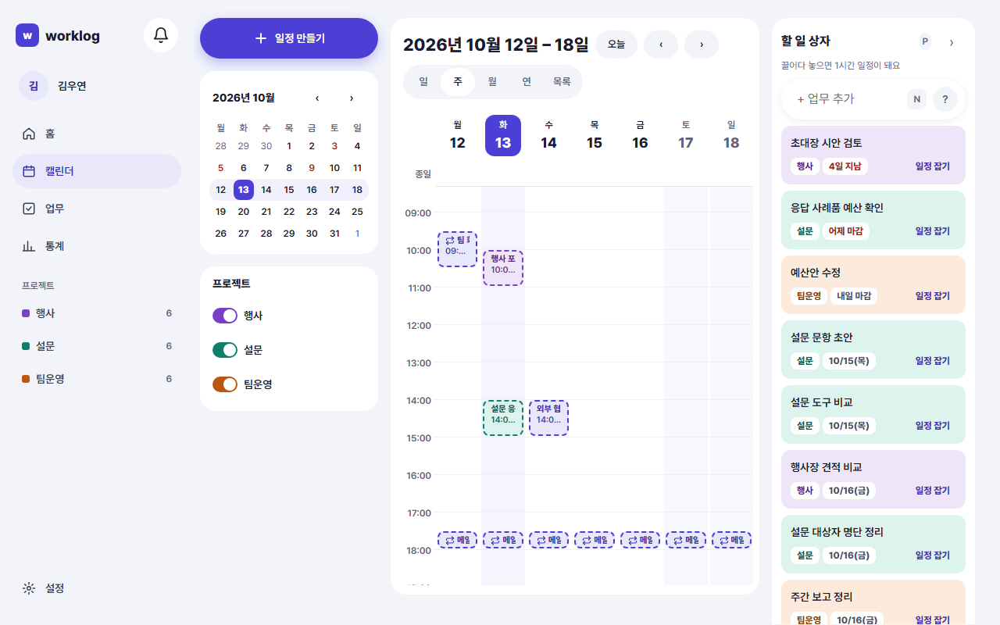
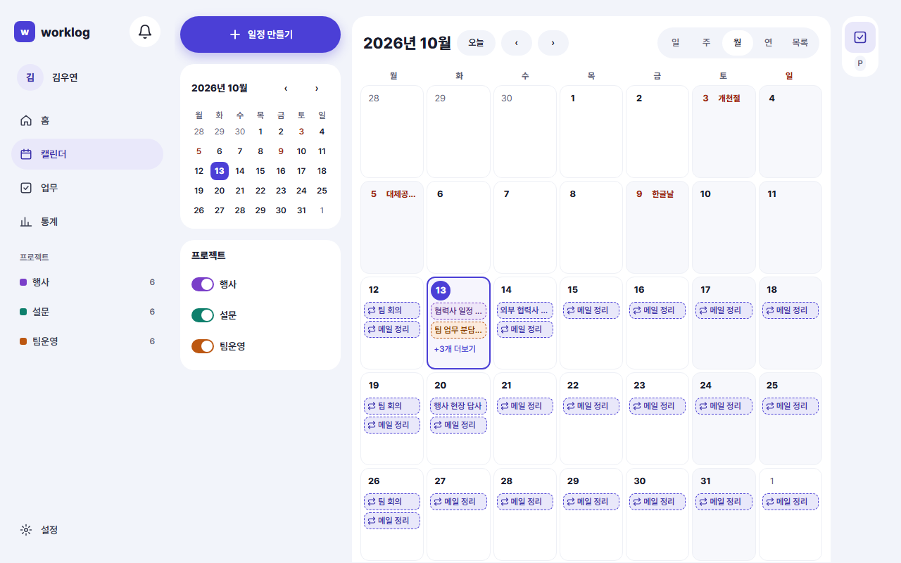
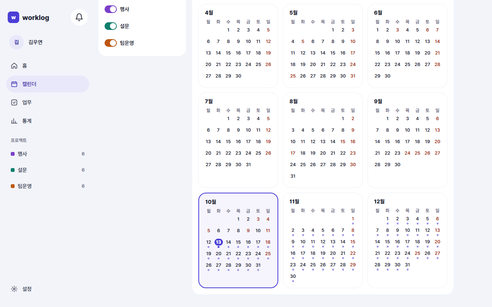
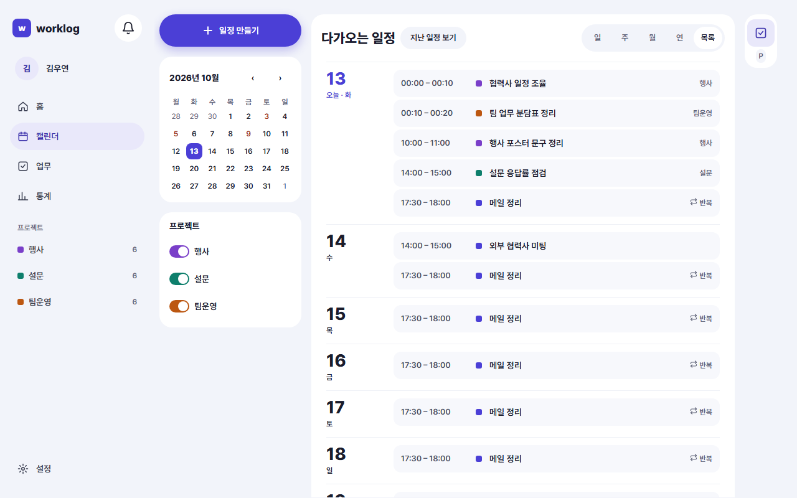
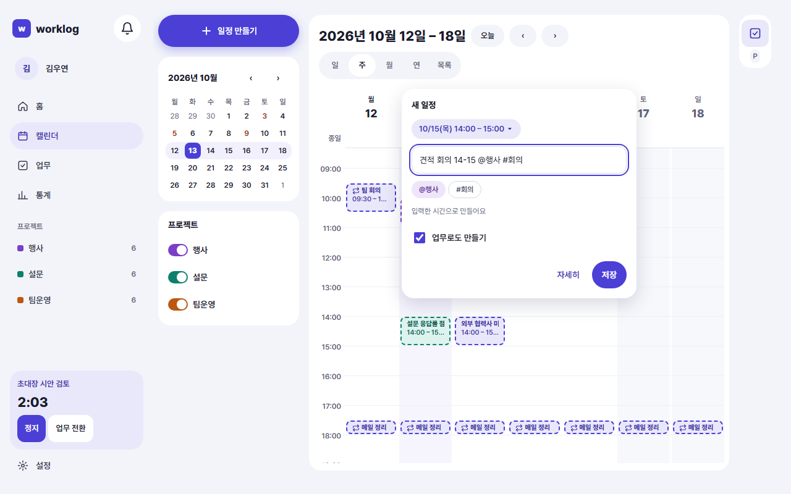
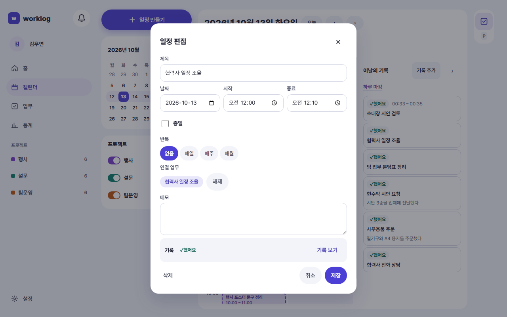
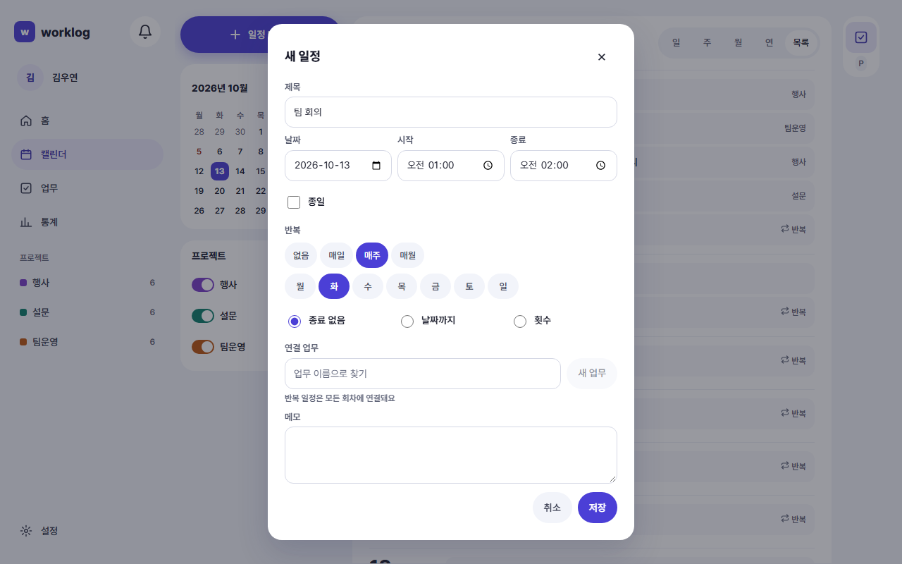
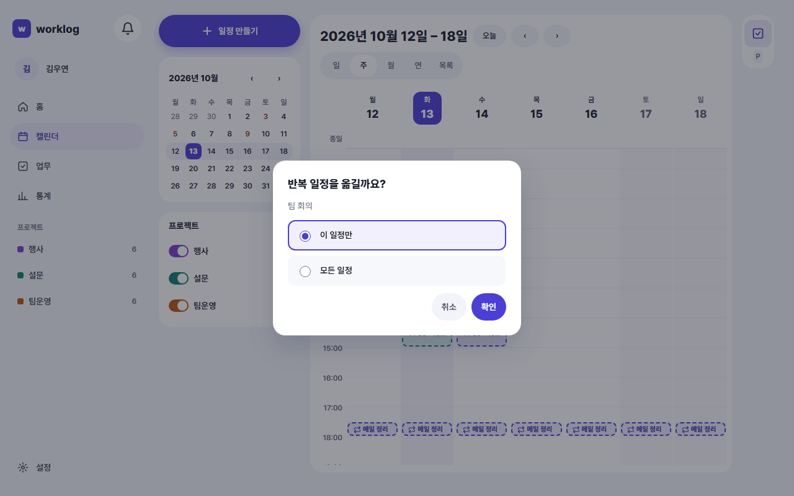
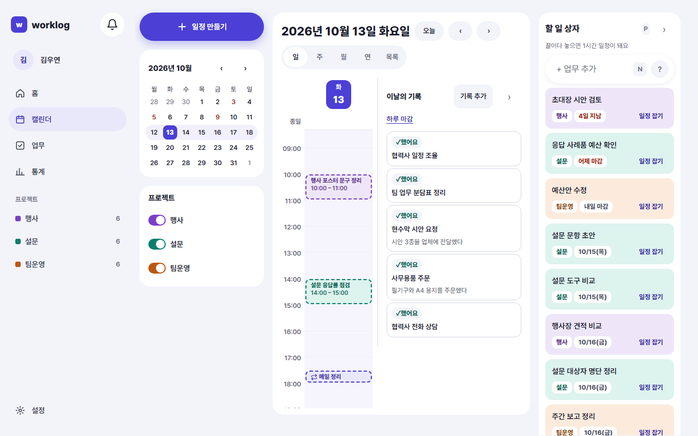
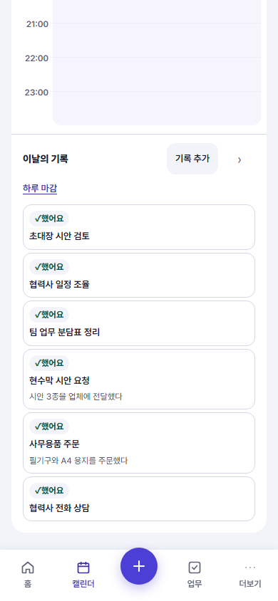

<!-- 담당: WY-ux3. 규칙·화면 목록은 README.md 장 배정 -->
<!-- 근거: SCH-01~07, REC-03, UX-03, SCR-CAL-01·02·03·04·05·06·07·08·09, D-71·D-72, D-105. 화면 문구·동작은 CalendarPage·TimeGrid·MonthView·QuickCreate·ScheduleDialog·ScopeDialog·TaskPanel·DayRecords·useScheduleActions·touchHold 코드 기준(feature/records-only 2026-10-12) -->
# 6. 일정과 캘린더

이 장을 읽으면 캘린더에서 일정을 만들고, 옮기고, 반복으로 잡고, 업무를 시간에 끌어다 놓는 방법을 알 수 있어요.

## 일정은 "언제 할지"를 적어 두는 것이에요

일정은 캘린더에 잡아 둔 시간이에요. 일정이 있다고 그 일을 한 것으로 치지 않아요. 한 일은 기록으로 따로 남아요(3장).

- 일정은 업무를 연결해도 되고 안 해도 돼요. "외부 협력사 미팅"처럼 업무가 없는 일정도 괜찮아요.
- 업무를 연결한 일정이 끝나면 앱이 **확인 대기**를 만들어 두고, 내가 확인하면 기록이 돼요.

## 캘린더 화면

사이드바의 **캘린더**를 누르면 열려요. 웹은 주 보기, 모바일은 일 보기로 열려요.

위쪽에서 날짜와 보기를 바꿔요.

| 이름 | 하는 일 | 단축키 |
|---|---|---|
| 오늘 | 오늘이 있는 날·주·달로 돌아와요 | T |
| ‹ › | 이전·다음 날(주·달·해)로 가요 | K / J |
| 일·주·월·연·목록 | 보기를 바꿔요 | D · W · M · Y · A |
| 일정 만들기 | 새 일정을 만들어요 | C |
| 업무 패널 접기·펼치기 | 오른쪽 업무 목록을 접고 펼쳐요 | P |

단축키는 입력창에 글자를 쓰는 중에는 동작하지 않아요. 설정 › 일반에서 끌 수도 있어요(9장).

왼쪽 사이드바에는 작은 달력과 **프로젝트** 목록이 있어요. 프로젝트 이름을 누르면 그 프로젝트의 일정이 캘린더에서 숨겨지고, 다시 누르면 돌아와요. 숨김은 이 브라우저에만 기억돼요.

### 지금과 오늘 찾기

- 일·주 보기에서 오늘 날짜 머리글이 구분돼 보이고, 오늘 열에는 지금 시각을 가리키는 선이 그어져요.
- 월·연 보기에서도 오늘 날짜가 구분돼요.
- 다른 날로 갔다면 **오늘**을 눌러 돌아와요.
- 월 보기에서 공휴일은 날짜 옆에 이름이 보여요.

## 보기마다 쓰임이 달라요

| 보기 | 이럴 때 써요 |
|---|---|
| 일 | 하루를 15분 단위로 짜고, 오른쪽에서 **이날의 기록**을 함께 봐요 |
| 주 | 이번 주 일정을 한눈에 보고 끌어서 옮겨요 |
| 월 | 한 달의 분포를 봐요. 날짜 칸에 일정이 최대 3개까지 보여요. 모바일에서는 일정이 점으로 보이고, 날짜를 누르면 그날 일 보기로 가요 |
| 연 | 일 년의 흐름을 봐요. 날짜나 달을 누르면 그곳으로 가요 |
| 목록 | 다가오는 일정을 줄줄이 봐요. **지난 일정 보기**로 이전 것도 불러와요 |

### 일정이 많은 날

- 일·주 보기에서 일정이 겹치면 옆으로 나란히 놓여요. 너무 많이 겹치면 일부가 **"14시대 일정 3개 더"** 같은 버튼으로 묶여요. 누르면 그 일정들이 목록으로 펼쳐지고, 목록에서 고르면 상세가 열려요.
- 월 보기에서 하루에 일정이 4개 이상이면 두 개만 보이고 **+n개 더보기**가 나와요. 누르면 그날의 일정이 모두 담긴 작은 창이 열려요.
- 날짜 숫자를 누르면 그날의 일 보기로 가요.

## 일정 만들기

세 가지 길이 있어요. 모두 같은 "새 일정" 창에서 끝나요.

1. **빈 시간대를 누르거나 끌어요.** 일·주 보기에서 빈 칸을 누르면 그 시각에서 시작하는 일정이, 위아래로 끌면 끈 만큼의 일정이 잡혀요. 15분 단위로 맞춰져요. 월 보기에서는 날짜 칸의 빈 곳을 누르면 그날의 종일 일정을 만들어요.
2. **일정 만들기** 버튼 또는 **C**.
3. **업무 패널의 업무**를 시간대에 끌어다 놓아요(아래 "업무를 일정으로").

빠른 만들기 창에서는 이렇게 해요.

- **한 줄 입력**에 이름과 시간을 같이 적어도 돼요. 예: `견적 회의 14-15 @행사 #회의`. 시간은 일정으로 읽히고 `@`·`#`은 업무에 넣을 프로젝트·태그로 읽혀요(7장).
- 위쪽의 날짜·시간을 눌러 바꿀 수 있어요.
- **업무로도 만들기**를 켜면 일정과 함께 업무도 만들어져 서로 연결돼요.
- **저장**을 누르면 끝나요. 더 정할 것이 있으면 **자세히**로 전체 창을 열어요.

### 일정 상세 창

일정 블록을 누르면 상세 창이 열려요. 새 일정을 만들 때와 같은 창이에요.

| 항목 | 설명 |
|---|---|
| 제목 | 필수예요. 비우면 "일정 이름을 적어 주세요"가 나와요 |
| 날짜·시작·종료 | 종료는 시작보다 뒤여야 해요 |
| 종일 | 켜면 시각 없이 날짜만 잡아요. 날짜 위쪽 **종일** 줄에 보여요 |
| 반복 | 없음 · 매일 · 매주(요일 선택) · 매월 |
| 반복 종료 | 종료 없음 · 날짜까지 · 횟수(1~999) |
| 메모 | 5000자까지 적어요 |
| 연결 업무 | 업무 이름으로 찾아 연결해요. **새 업무**로 바로 만들 수도 있고, **해제**로 끊어요 |
| 기록 | 이 일정에서 남긴 기록의 상태와 **기록 보기** |

일정이 끝난 뒤에 열어 보면 **기록** 줄에서 상태를 알 수 있어요. 상태 이름은 **했어요 · 확인 대기 · 안 했어요**이고, 남긴 기록이 없으면 "이 일정에서 남긴 기록이 없어요"라고 나와요.

## 옮기기·길이 바꾸기·삭제

모두 확인 창 없이 바로 실행되고, 화면 아래에 **되돌리기**가 5초 동안 떠요(9장).

| 하고 싶은 일 | 방법 |
|---|---|
| 시간·날짜 옮기기 | 일정 블록을 끌어 놓아요. 15분 단위로 맞춰져요. 월 보기에서는 다른 날짜 칸으로 끌어요 |
| 길이 바꾸기 | 일·주 보기에서 블록 아래 끝을 끌어요 |
| 자세히 고치기 | 블록을 눌러 상세에서 고치고 **저장**해요 |
| 삭제 | 상세 창의 **삭제**. "일정을 삭제했어요" 토스트가 뜨고 5초 안에 **되돌리기**를 누르면 돌아와요 |

키보드로는 일정 블록을 열어 상세 창에서 시간을 바꿔요.

### 휴대폰에서 끌기

손가락으로는 스크롤과 끌기가 겹치지 않도록 이렇게 동작해요.

- 바로 밀면 **스크롤**돼요.
- 짧게 누르면 일정이 **열려요**.
- 약 0.5초 **길게 누른 뒤에** 움직이면 만들기·옮기기·길이 바꾸기가 시작돼요.

길게 누르는 동안 손가락이 많이 움직이면 스크롤로 보고 끌기를 시작하지 않아요.

## 반복 일정

일정 상세의 **반복**에서 매일·매주·매월을 정해요. 예: "매주 월 09:30 팀 회의", "매일 17:30 메일 정리".

- 매주를 고르면 요일을 고를 수 있어요. 시작일의 요일은 반드시 포함해야 해요.
- 반복은 **종료 없음**, **날짜까지**, **횟수** 중에서 끝을 정해요.
- 반복 일정에 업무를 연결하면 **모든 회차에 연결**돼요.

### "이 일정만"과 "모든 일정"

반복 일정을 옮기거나 고치거나 지우려고 하면 어느 범위인지 물어요.

| 선택 | 바뀌는 범위 |
|---|---|
| 이 일정만 | 누른 회차 하나 |
| 모든 일정 | 반복 전체 |

- 질문 제목은 하려는 일에 따라 "반복 일정을 옮길까요?", "수정할까요?", "삭제할까요?"로 달라요.
- **취소**를 누르면 아무것도 바뀌지 않아요.
- 일정을 지우거나 시각·반복을 바꾸면 그 일정에 이미 만들어진 확인 대기는 지워져요.

## 업무를 일정으로

오른쪽 **업무 패널**(맨 위에 "할 일 상자"라고 적혀 있어요)에는 아직 끝내지 않은 업무가 마감일 순으로 보여요.

- 상태가 **할 일·진행 중·보류**인 업무만 나와요. 완료한 업무는 안 나와요.
- 한 번에 30개씩 보이고 **더 불러오기**로 이어서 봐요. 마감일이 없는 업무는 **날짜 없는 업무 n개 더 보기**로 따로 열어요.
- 맨 위 입력칸 **+ 업무 추가**에 한 줄로 적어 바로 업무를 만들 수 있어요.

일정을 잡는 방법은 두 가지예요.

1. 업무 카드를 캘린더의 원하는 시간대로 **끌어다 놓아요.** "끌어다 놓으면 1시간 일정이 돼요"라는 안내처럼, 그 업무가 연결된 1시간짜리 일정이 생겨요. 시간은 나중에 고칠 수 있어요.
2. 카드의 **일정 잡기**를 눌러요. 새 일정 창이 그 업무가 연결된 채로 열려요. 끌기가 어려운 휴대폰이나 키보드로 쓸 때는 이 방법을 써요.

일정을 잡아도 업무의 상태는 바뀌지 않아요. 업무가 끝났을 때는 업무 쪽에서 완료해요(5장).

패널이 좁은 화면에서는 접혀 있어요. 오른쪽 가장자리의 업무 아이콘(**업무 패널 펼치기**)을 누르거나 **P**를 누르면 펼쳐져요. 1280px 이상의 넓은 화면에서는 처음부터 펼쳐져 있어요.

## 계획과 기록은 이렇게 구분해요

일 보기는 두 가지를 함께 보여 줘요.

- **가운데 시간표**: 계획이에요. 일정이 있던 자리예요.
- **오른쪽 "이날의 기록"**: 그날 남긴 기록이에요. 항목마다 **했어요·확인 대기·안 했어요** 표시와, 일정에서 온 기록이면 "계획 14:00–15:00" 같은 계획 시간이 붙어요. 항목을 누르면 기록을 열어 고칠 수 있어요.

- **기록 추가**로 일정과 상관없는 기록을 직접 남겨요.
- **하루 마감**은 오늘과 지난 날에서만 보여요. 눌러서 그날의 확인 대기를 정리하고 마감해요(4장).
- 접었을 때는 "3건 · 대기 1 · 마감함"처럼 요약만 보여요.
- 시간 기록 옵션을 켜면 일 보기가 **계획**과 **실제** 두 열로 바뀌어 실제로 한 시간이 따로 보여요(8장).

모바일의 일 보기에서는 시간표 아래에 이날의 기록이 이어져요.

<!-- 촬영 목록: 파일 이름 | 화면 ID | W/M | 찍을 상태
SCR-CAL-01_W.png | SCR-CAL-01 | W | 주 보기, 오늘 열·지금 선이 보이게, 업무 패널 펼친 상태
SCR-CAL-02_W.png | SCR-CAL-02 | W | 일 보기 + 이날의 기록(확인 대기·했어요 섞임)
SCR-CAL-02_M.png | SCR-CAL-02 | M | 모바일 일 보기(시간표 아래에 이날의 기록)
SCR-CAL-03_W.png | SCR-CAL-03 | W | 월 보기, 하루에 일정 4개 이상인 날 하나(+n개 더보기 보임)
SCR-CAL-04_W.png | SCR-CAL-04 | W | 연 보기
SCR-CAL-05_W.png | SCR-CAL-05 | W | 목록 보기
SCR-CAL-06_W.png | SCR-CAL-06 | W | 빈 시간대를 눌러 연 빠른 만들기 창, 한 줄 입력에 예시 입력
SCR-CAL-07_W.png | SCR-CAL-07 | W | 일정 상세 창, 이미 끝난 일정(기록 줄이 보이게)
SCR-CAL-07_W_반복.png | SCR-CAL-07 | W | 일정 상세 창에서 반복을 매주로 고른 상태(요일·종료 보임)
SCR-CAL-08_W.png | SCR-CAL-08 | W | 반복 일정을 끌었을 때의 범위 질문 창
SCR-CAL-09_W.png | SCR-CAL-09 | W | 일 보기 + 업무 패널(업무 카드 몇 개) -->
<!-- 용어 확인 요청(WY-planner): 업무 패널 제목이 화면에 "할 일 상자"라고 적혀 있다. 03-용어.md는 "할 일은 업무의 상태"라고 풀어서, 이 장은 "업무 패널(맨 위에 '할 일 상자'라고 적혀 있어요)"로 썼다. 화면 문구를 바꿀지 매뉴얼에서 이렇게 풀지 정해 주세요 -->
<!-- 자주 묻는 질문 후보: 일정을 옮겼는데 되돌리고 싶어요(5초 안에 되돌리기, Ctrl+Z) / 반복 일정 하나만 바꾸고 싶어요(이 일정만) / 휴대폰에서 일정이 스크롤만 돼요(길게 눌러 끌기) / 일정을 잡았는데 업무가 완료가 안 돼요(일정과 업무 상태는 따로) / 특정 프로젝트 일정만 가리고 싶어요(사이드바 프로젝트 누르기) / 업무 패널이 안 보여요(P 또는 오른쪽 아이콘) -->
