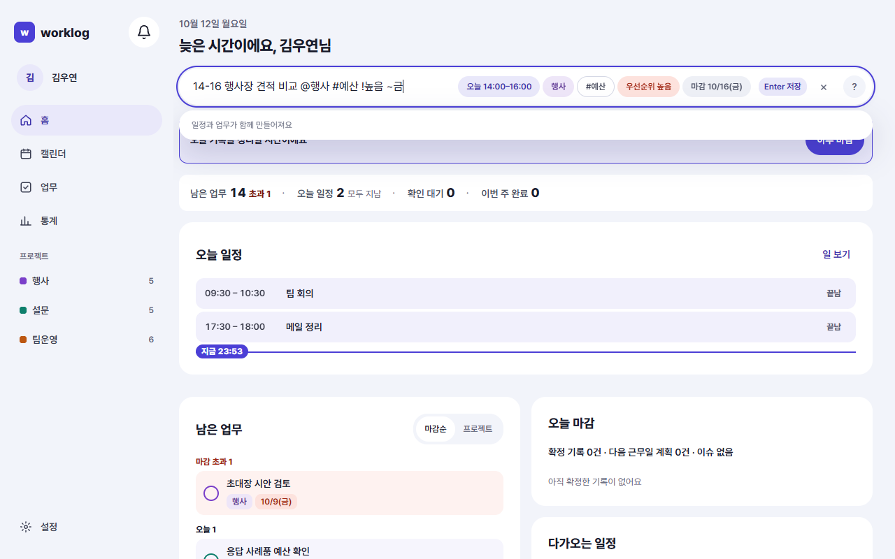
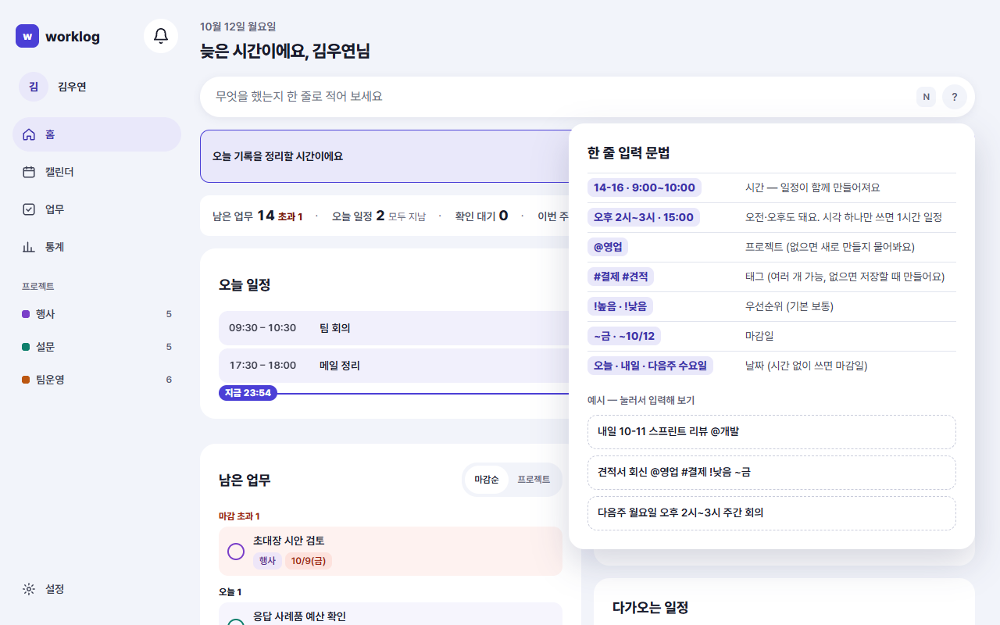

<!-- 담당: WY-ux2. 규칙·화면 목록은 README.md 장 배정 -->
<!-- 근거: 요구사항정의서 v2.4 REC-04·SCH-05, 화면 SCR-COM-02·SCR-ONB-02·SCR-MOB-01·SCR-COM-03, 결정 D-62·D-67·D-94·D-106·D-182. 문법 규칙은 frontend/src/quickInput/parse.ts·QuickInput.tsx·GrammarHelp.tsx 코드 기준(parse.test.ts로 예시 대조 필요) -->
<!-- 초안 2026-10-12 (WY-ux2). 예시 프로젝트 이름은 README 가상 데이터의 짧은 이름(@행사 @설문 @팀운영) -->
# 7. 빠른 입력

이 장을 읽으면 한 줄로 업무를 만들고, 시간을 적어 일정까지 한 번에 잡는 법을 알 수 있어요.

## 어디서 적나요

빠른 입력창은 같은 모양으로 여러 곳에 있어요. 어디서 적어도 같은 문법이에요.

| 어디 | 어떻게 |
|---|---|
| 홈 | 화면 맨 위 입력창 |
| 업무 목록 | 목록 위 입력창 |
| 캘린더 | 일 보기 옆 업무 패널의 입력창 |
| 모바일 | 하단 탭 가운데 **+** 버튼 → "빠른 기록" 시트 |
| 어디서든 | **N** 키(입력창에 포커스가 없을 때), 또는 **Ctrl+K**로 명령 팔레트를 열어 '업무 추가' |

적은 뒤 **Enter**를 누르면 저장돼요. 모바일 시트에서는 입력칸 안의 **저장** 버튼을 눌러요.

## 한 줄에 쓸 수 있는 것

낱말을 공백으로 띄워 적어요. **순서는 상관없어요.** 시간·날짜·프로젝트·우선순위·마감은 종류마다 처음 쓴 것 하나만 읽어요. 읽지 못한 낱말은 모두 제목이 돼요.

| 쓰는 것 | 적는 법 | 예 |
|---|---|---|
| 제목 | 나머지 낱말 | 초대장 시안 검토 |
| 시간 | `시작-끝` (24시간제) | `14-16` · `9:30-10:30` · `9:00~10:00` |
| 시각 하나 | 시각만 | `15:00` · `14시` · `오후 3시` → 1시간 일정 |
| 날짜 | 말이나 날짜 | `오늘` · `내일` · `모레` · `수요일` · `다음주 수요일` · `10/12` · `10월 12일` |
| 프로젝트 | `@이름` | `@행사` |
| 태그 | `#이름` (여러 개 가능) | `#예산 #외부` |
| 우선순위 | `!높음` · `!보통` · `!낮음` | `!높음` |
| 마감 | `~날짜` | `~금` · `~내일` · `~10/12` |

시간은 `오전`·`오후`를 붙일 수 있어요(`오후 2시~3시`). 구분자는 `-` `~`이고 앞뒤에 공백이 있어도 돼요(`14:00 - 15:00`).

## 시간을 쓰면 무엇이 만들어지나요

**시간을 적었는지가 가장 큰 차이예요.**

| 적은 것 | 만들어지는 것 |
|---|---|
| 시간 **없음** | **업무**만 |
| 시간 **있음** | **업무**와, 그 업무에 연결된 **일정**을 함께 |
| 날짜만(시간 없음) | 업무만, 그 날짜가 **마감일** |
| `~날짜` | 업무의 **마감일**(일정은 만들지 않아요) |

입력창 아래 안내가 지금 무엇이 만들어질지 미리 알려 줘요. "업무가 만들어져요" 또는 "일정과 업무가 함께 만들어져요"예요.

> 시간을 적어 만든 일정이 끝나면, 앱이 그 일정의 **확인 대기**를 만들어 홈에서 "했어요"를 묻는 흐름으로 이어져요(4장).

## 예시 모음

아래 예시는 가나다상사 마케팅팀 대리가 쓰는 입력이에요. 오늘이 월요일이라고 가정해요.

### 업무만 만들기

| 입력 | 만들어지는 것 |
|---|---|
| `예산안 수정` | 업무 "예산안 수정". 상태 할 일, 마감 없음 |
| `예산안 수정 !높음` | 업무 + 우선순위 높음 |
| `주간 보고 정리 ~금` | 업무 + 마감 금요일 |
| `설문 문항 초안 @설문 #보고` | 업무 + 프로젝트 '설문' + 태그 #보고 |
| `예산안 수정 내일` | 업무 + 마감 내일(시간이 없어서 일정은 없어요) |

### 시간을 쓰면 일정도 함께

| 입력 | 만들어지는 것 |
|---|---|
| `14-16 행사장 견적 비교` | 업무 + 오늘 14:00–16:00 일정 |
| `내일 10-11 설문 문항 초안 @설문` | 업무(프로젝트 설문) + 내일 10:00–11:00 일정 |
| `오후 3시 팀 회의` | 업무 + 오늘 15:00–16:00 일정(시각 하나는 1시간) |
| `다음주 월요일 오후 2시~3시 주간 보고 정리` | 업무 + 다음 주 월요일 14:00–15:00 일정 |
| `14-16 행사장 견적 비교 @행사 #예산 !높음 ~금` | 업무(프로젝트 행사, 태그 #예산, 우선순위 높음, 마감 금요일) + 오늘 14:00–16:00 일정 |

> 마지막 예시처럼 시간과 `~마감`을 같이 쓰면, **일정은 시간대로 잡히고 마감일은 업무에 붙어요.** 두 가지가 따로 적용돼요.

### 날짜 쓰는 법

| 쓰고 싶은 날 | 적는 법 |
|---|---|
| 오늘·내일·모레 | `오늘` `내일` `모레` |
| 이번 주 수요일 | `수요일` · `이번주 수` |
| 다음 주 수요일 | `다음주 수요일` · `다음주 수` |
| 10월 12일 | `10/12` · `10월 12일` |

- 요일만 쓰면 **오늘을 포함해** 가장 가까운 그 요일이에요. 월요일에 `월요일`이라고 쓰면 오늘이에요.
- `월/일`만 쓰면 오늘에서 가장 가까운 해의 날짜예요.
- 한 글자 요일(`수`)은 `다음주 수`처럼 주 앞말이 있거나 `~수`처럼 마감일 때만 읽어요. 그냥 `수`는 제목으로 남아요("일 정리"를 요일로 읽지 않으려는 규칙이에요).

## 적는 동안 보이는 칩

입력하는 동안 읽은 내용이 칩으로 보여요. 칩이 의도와 다르면 저장하기 전에 고칠 수 있어요.

- **시간 칩**: "오늘 14:00–16:00"처럼 날짜와 시각이 보여요.
- **프로젝트 칩**: 프로젝트 색으로 보여요.
- **태그 칩**: 태그마다 하나씩. 없는 태그는 점선으로 "+ 새 태그 '이름'"이라고 알려 줘요(저장할 때 자동으로 만들어요).
- **우선순위·마감 칩**: "우선순위 높음", "마감 금 …"처럼 보여요.

칩을 누르면 그 값만 고르는 메뉴가 열려요(예: 마감을 오늘·내일·금요일 중에서 선택). 메뉴에서 **빼기**를 고르면 그 낱말이 입력에서 빠져요.

## 읽지 못했을 때

| 상황 | 화면 | 고치는 법 |
|---|---|---|
| 제목이 없어요(`14-16`만 적음) | "할 일 이름을 적어 주세요" | 제목을 덧붙여요 |
| 없는 프로젝트(`@신규`) | 점선 칩 "+ 새 프로젝트 '신규'". Enter를 누르면 "프로젝트를 새로 만들까요?"라고 물어요 | 칩을 누르거나 Enter를 한 번 더 눌러요 |
| 시간처럼 보이는데 읽지 못함(`15:00까지`) | "시간으로 읽지 못했어요: 15:00까지" | `15:00` 또는 `14-15`처럼 고쳐요 |
| 우선순위를 잘못 적음(`!1`) | "우선순위는 !1 대신 !높음·!보통·!낮음으로 적어요" | `!높음`으로 고쳐요 |

> 숫자만 적은 것(`14 보고서`)이나 `3시간 회의`의 `3시간`은 시간으로 읽지 않아요. 제목으로 남아요.

## 알아 두면 좋은 것

- **프로젝트 이름에 공백이 있으면 `@`로 쓸 수 없어요.** `@`는 한 낱말이라서 이름이 공백 앞에서 끊겨요. 이런 프로젝트는 입력 뒤 업무 상세의 **프로젝트** 칸에서 골라요.
- `오전`·`오후` 없이 `2시-3시`라고 쓰면 새벽 2시~3시로 읽어요. 오후라면 `오후 2시~3시` 또는 `14-15`로 적어요.
- 시작보다 끝이 이르면 오후로 읽어요: `11-1`은 11:00–13:00이에요.
- 같은 이름의 태그는 하나로 합쳐져요(`#예산 #예산`). 프로젝트(`@`)는 처음 하나만 읽고, 두 번째부터는 제목에 남아요.
- 저장하면 "업무 1개를 추가했어요" 또는 "업무와 일정 1개를 추가했어요"가 떠요. 잘못 만들었다면 **되돌리기**를 눌러요. 새로 만든 태그는 되돌려도 남아요.
- 처음 쓸 때 입력칸 오른쪽 **?** 를 누르면 문법 도움말이 열려요. 예시를 누르면 입력창에 채워져요.

## 자주 하는 업무 제안

입력창이 비어 있을 때 입력창을 누르면 "자주 하는 업무"가 최대 3개 떠요. 같은 요일·같은 시간대에 2번 이상 만든 업무예요. 누르면 제목·프로젝트·태그가 입력창에 채워지니 시간을 덧붙여 Enter만 누르면 돼요.

<!-- 촬영 목록: SCR-COM-02_W.png | SCR-COM-02 | W | 홈 빠른 입력창에 `14-16 행사장 견적 비교 @행사 #예산 !높음 ~금` 입력 중, 해석 칩(시간·프로젝트·태그·우선순위·마감)과 "일정과 업무가 함께 만들어져요" 안내 보임 / SCR-ONB-02_W.png | SCR-ONB-02 | W | 입력창 ? 눌러 문법 도움말 팝오버 열림(규칙 7줄 + 예시 3개) -->
<!-- 확인 필요(WY-qa): ② 이미 끝난 시간(예: 지금이 15시인데 `9-10`)으로 적어도 일정이 만들어지고 확인 대기가 이어지는지 앱에서 확인 필요(원고는 단정하지 않음) ③ 캘린더 업무 패널의 입력창 위치·모양 확인(06장 WY-ux3와 이음매) -->
<!-- 자주 묻는 질문 후보: 시간을 적었는데 제목에 시간이 들어갔어요(읽지 못한 모양 — 15:00까지, 14—15 등) / @프로젝트를 썼더니 새 프로젝트를 만들라고 해요(이름이 없거나 공백이 있는 프로젝트) / 날짜만 적었더니 일정이 안 생겨요(마감일이 됨) / Enter를 눌렀는데 저장이 안 돼요(한글 입력 중 Enter는 글자 확정, 한 번 더) / 일정 말고 업무만 만들고 싶어요(시간을 빼고 적기) -->
