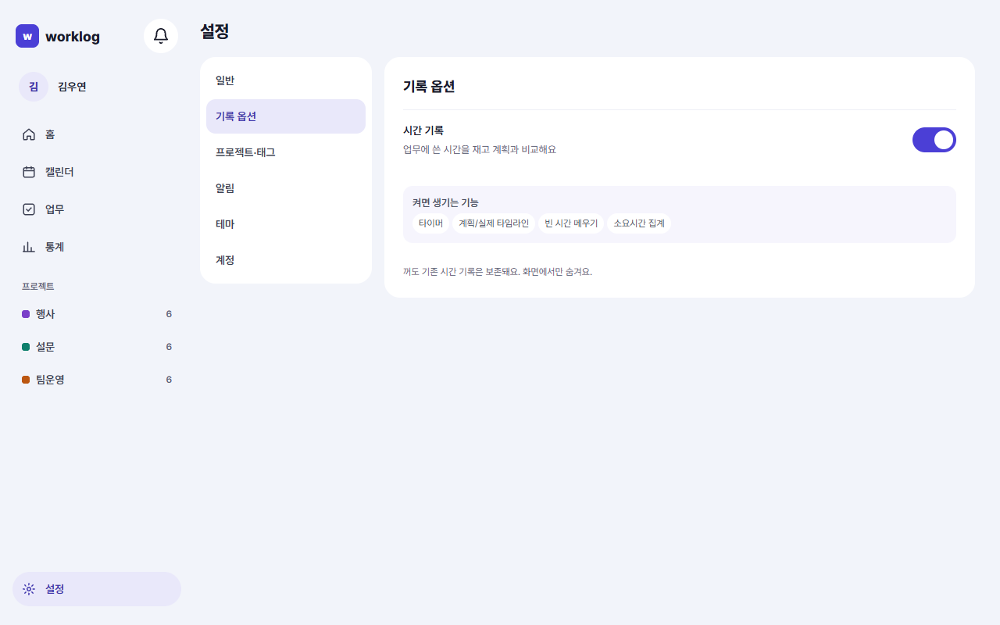
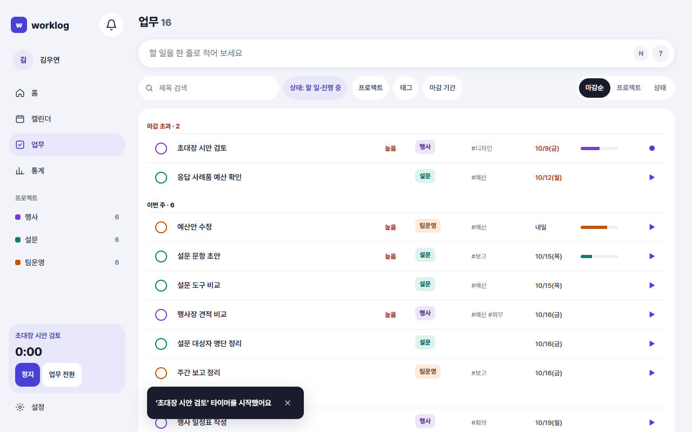
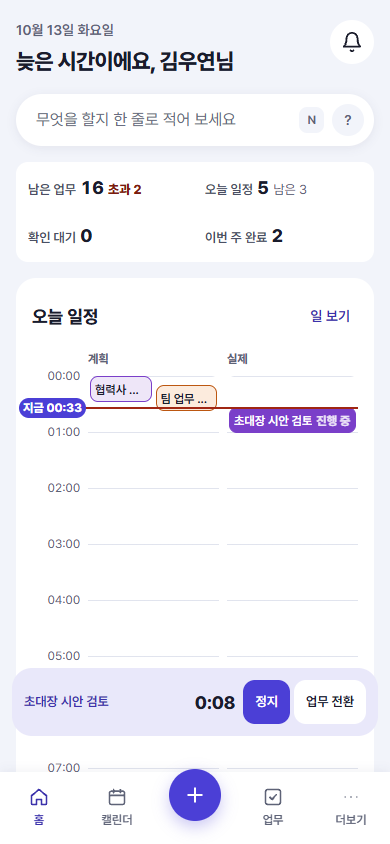
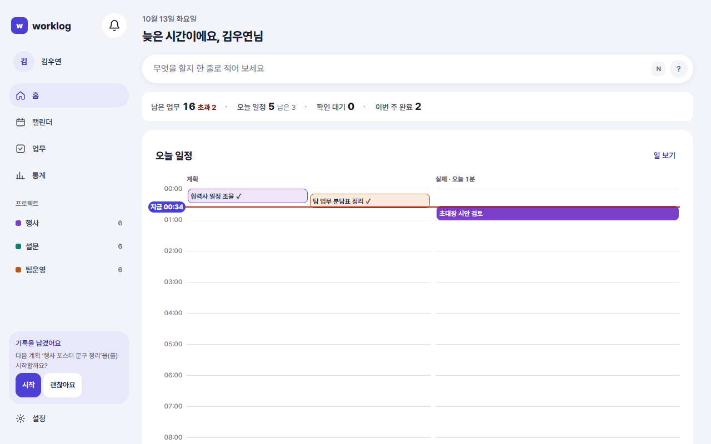

<!-- 담당: WY-ux2. 규칙·화면 목록은 README.md 장 배정 -->
<!-- 근거: 요구사항정의서 v2.4 TIME-01~11, 화면 SCR-SET-03·SCR-COM-06·SCR-HOME-03, 결정 D-97·D-98·D-100·D-101·D-102·D-103·D-212·D-213. 동작은 frontend/src/timer·home·settings 코드와 contracts/worklog.yaml 기준 -->
<!-- 초안 2026-10-12 (WY-ux2) -->
# 8. 시간 기록(옵션)

이 장을 읽으면 업무에 쓴 시간을 재는 법과, 비어 있는 시간을 채우는 법을 알 수 있어요.

## 먼저 알아 둘 것

- 시간 기록은 **옵션**이에요. 처음에는 **꺼져 있어요.** 꺼져 있어도 업무·일정·기록은 모두 쓸 수 있어요.
- 켜면 업무에 쓴 시간을 재서, 계획과 실제를 나란히 볼 수 있어요.
- 껐다 켜도 기존 시간 기록은 **지워지지 않아요.** 화면에서만 숨겨요.

## 켜기

1. 사이드바 아래 **설정**을 열어요(모바일은 더보기 › 설정).
2. **기록 옵션**을 눌러요. (명령 팔레트 Ctrl+K에서 "기록 옵션"을 찾아도 돼요.)
3. **시간 기록** 스위치를 켜요. 누르는 즉시 저장돼요.

스위치 아래 "켜면 생기는 기능"에 네 가지가 적혀 있어요.

| 기능 | 하는 일 |
|---|---|
| 타이머 | 업무를 시작할 때 누르고, 끝나면 멈춰요. 시간이 기록돼요 |
| 계획/실제 타임라인 | 홈에서 계획과 실제를 두 열로 나란히 봐요 |
| 빈 시간 메우기 | 기록이 없는 시간을 한 번에 채워요 |
| 소요시간 집계 | 오늘 쓴 시간을 합쳐서 보여 줘요 |

## 켜기 전과 후, 홈은 이렇게 달라요

| | 시간 기록 꺼짐 | 시간 기록 켜짐 |
|---|---|---|
| 홈 '오늘 일정' | 계획 목록. 일정마다 **했어요** · **수정** · **안 했어요** | **계획**과 **실제** 두 열 |
| 시간 합계 | 없음 | '실제' 머리글에 "오늘 N시간" |
| 비어 있는 시간 | 안 보여요 | 점선 **빈 시간** 버튼 |
| 기록 입력 창 | 한 일과 결과만 | 시작~종료 또는 소요시간 칸이 더해져요 |

켠 뒤에도 '시간 없이 남긴 기록'은 하단에 "시간 없이 남긴 기록 n건"으로 따로 모여요. 시간을 적지 않은 기록도 그대로 남아요.

## 타이머

### 시작하기

업무를 시작할 때 타이머를 켜요. 시작하는 길은 여러 곳이에요.

| 어디서 | 어떻게 |
|---|---|
| 업무 목록 | 업무 줄의 **▶** 버튼(완료한 업무에는 없어요) |
| 일정 상세 | **이 일정으로 타이머 시작**(오늘 일정 중 아직 끝나지 않은 것) |
| 명령 팔레트 | Ctrl+K → "타이머 시작" |
| 모바일 빠른 기록 시트 | **지금 하는 일로 타이머 시작** |

"타이머 시작" 창이 열리면 업무를 고르고 **시작**을 눌러요. 업무가 없는 일은 **할 일** 칸에 적어요. 업무를 고르면 칸을 비워도 돼요(비우면 업무 제목이 쓰여요). 둘 다 비어 있으면 "업무를 고르거나 할 일을 적어 주세요"가 떠요.

### 돌아가는 동안

타이머가 돌면 **미니 플레이어**가 나타나요. 데스크톱은 사이드바 아래, 모바일은 하단 탭 위쪽이에요.

미니 플레이어에는 업무 이름, 흐른 시간, **정지**, **업무 전환**이 있어요.

- 흐른 시간은 서버에 적힌 시작 시각으로 재요. **브라우저를 닫아도, 다른 기기에서 열어도** 이어서 보여요.
- 타이머는 **한 번에 하나**예요. 다른 업무로 시작하면 먼저 돌던 타이머가 멈추고 기록이 남아요.
- **업무 전환**을 누르면 지금 것을 멈추고 새 업무로 바로 시작해요.

### 멈추기

**정지**를 누르면 흐른 시간만큼 기록이 남아요. 알림 문구는 상황마다 달라요.

| 상황 | 알림 | 기록 |
|---|---|---|
| 보통 | "기록을 남겼어요" | 시작~정지 시각으로 기록 |
| 1분이 안 됨 | "1분이 안 돼서 기록하지 않았어요" | 기록하지 않아요 |
| 24시간이 넘음 | "24시간이 넘어 24시간까지만 기록했어요. 실제 시간으로 고쳐 주세요" + **시간 고치기** | 24시간까지만 |

- 정지는 **되돌리기가 없어요.** 잘못 멈췄으면 기록을 열어 시간을 고쳐요.
- 일정에서 시작한 타이머가 1분 안에 멈추면 "…계획은 확인 대기로 돌아갔어요"라고 알려 줘요.

### 일정에서 시작하면

일정에서 타이머를 시작하면, 그 일정의 **확인 대기가 따로 또 생기지 않아요.** 타이머로 잰 시간이 곧 그 일정의 기록이에요. 같은 일정에서 이미 기록했다면 "그 계획은 이미 기록했어요"라고 알려 줘요.

### 시간 기록이 꺼져 있을 때

옵션이 꺼져 있으면 시작이 안 되고 "시간 기록이 꺼져 있어요. 기록 옵션에서 켜 주세요"가 떠요.

### 이어서 시작하기

타이머를 멈추면, 오늘 이어질 계획이 있을 때 "다음 계획 '…'을(를) 시작할까요?"라고 물어요. **시작**을 누르면 바로 그 계획의 타이머가 돌아요. 아니면 **괜찮아요**를 눌러요.

물어 보는 계획은 오늘 시간이 정해져 있고, 취소하지 않았고, 지금보다 끝나는 시각이 뒤이고, 아직 기록이 없는 것이에요. 지금 진행 중인 계획이 있으면 그것이 먼저, 없으면 가장 빠른 것이 나와요.

## 빈 시간 메우기

일하다 보면 타이머를 켜지 않은 시간이 생겨요. 그런 시간은 홈의 **실제** 열에 점선 **빈 시간** 버튼으로 보여요.

### 빈 시간이란

- **업무 시간대** 안에서 확인된 기록이 없는 구간이에요. 업무 시간대는 설정 › 일반에서 정하고, 처음에는 09:00~18:00이에요.
- **15분 이상**인 구간만 보여요.
- 오늘이라면 **지금 이후**는 빈 시간으로 치지 않아요.

### 채우는 법

1. **빈 시간** 버튼을 눌러요. "빈 시간 메우기" 창이 열리고, 시간대와 길이가 위에 보여요.
2. 후보 중 하나를 눌러요. 누르는 즉시 기록이 만들어져요.

| 후보 | 뜻 |
|---|---|
| 직전 업무 이어서 | 바로 앞 기록의 업무로 채워요 |
| 이 시간 계획 · HH:MM – HH:MM | 그 시간에 잡아 둔 계획을 **했어요**로 확인하며 채워요 |
| 자주 하는 업무 | 이 시간대에 자주 한 업무예요 |
| 직접 입력 | "이 시간에 한 일"을 적고 **저장**해요 |

- 계획 후보를 누르면 그 계획의 **확인 대기가 기록으로 바뀌어요.** 같은 시간이 두 번 세어지지 않아요. 계획이 빈 시간보다 길면 빈 시간과 겹친 부분만 채워요.
- 채우면 "HH:MM – HH:MM을 채웠어요"와 **되돌리기**가 떠요. 되돌리면 새로 만든 기록은 보관되고, 확인했던 계획은 확인 대기로 돌아가요.

## 기록에 시간 적기

시간 기록이 켜져 있으면 기록을 직접 남기거나 고칠 때 시간 칸이 더해져요. 두 가지 중 편한 것을 써요.

- **시작~종료**: 예) 14:00~15:30
- **소요시간**: 예) 1시간 30분

종료가 시작보다 이르면 **다음 날**로 읽어요(24시간을 넘을 수는 없어요).

## 알아 두면 좋은 것

- 시간을 재지 않아도 하루 마감과 통계는 쓸 수 있어요. 시간 기록은 계획과 실제의 차이를 보고 싶을 때만 켜요.
- 기록에 시간이 없으면 '소요시간 집계'에는 들어가지 않아요. "시간 없이 남긴 기록"으로 따로 세요.
- 타이머는 **업무 목록 ▶ → 정지**만으로도 충분해요. 이어서 시작하기나 빈 시간 메우기는 필요할 때만 써요.

<!-- 촬영 목록: SCR-SET-03_W.png | SCR-SET-03 | W | 설정 › 기록 옵션, 시간 기록 스위치 켜짐 + "켜면 생기는 기능" 4항목 보임 / SCR-COM-06_W.png | SCR-COM-06 | W | 사이드바 아래 미니 플레이어(업무명·경과 시간·정지·업무 전환), 업무 전환 창은 따로 찍지 않아도 됨 / SCR-COM-06_M.png | SCR-COM-06 | M | 하단 탭 위 미니 플레이어 / SCR-HOME-03_W.png | SCR-HOME-03 | W | 시간 기록 켜짐 홈, 계획|실제 두 열에 점선 '빈 시간' 버튼 1개 이상, 실제 머리글에 "오늘 N시간" -->
<!-- 확인 필요(WY-qa): ① 기록 입력 창의 시간 칸 이름(시작~종료·소요시간)이 화면 문구와 같은지 ② 모바일 설정 › 기록 옵션 진입 경로(더보기 › 설정) ③ 미니 플레이어 모바일 위치 ④ '시간 없이 남긴 기록 n건' 문구 정확한 모양 ⑤ 일정에서 시작한 타이머를 1분 안에 멈췄을 때 알림 문구 전체 -->
<!-- 자주 묻는 질문 후보: 타이머를 켜 둔 채 퇴근했어요(24시간까지만 기록 → 시간 고치기) / 타이머 정지를 잘못 눌렀어요(되돌리기 없음, 기록에서 시간 고침) / 시간 기록을 껐더니 기록이 사라졌어요(숨겨질 뿐, 다시 켜면 보임) / 빈 시간 버튼이 안 보여요(업무 시간대·15분·지금 이후 아님) / 타이머가 두 개 돌 수 있나요(하나만) -->
