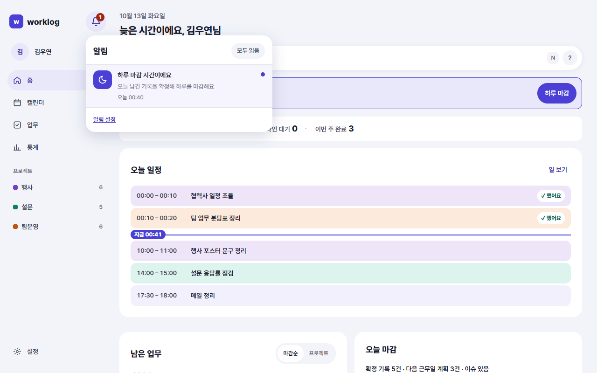
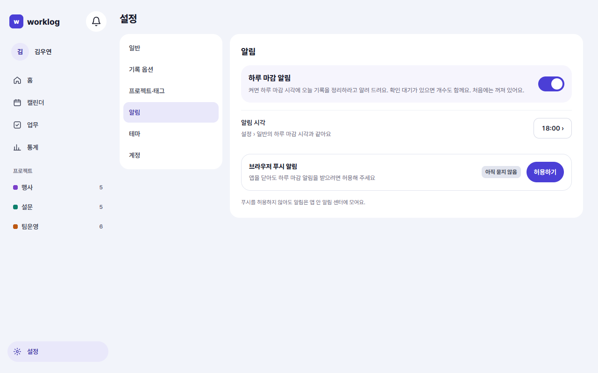
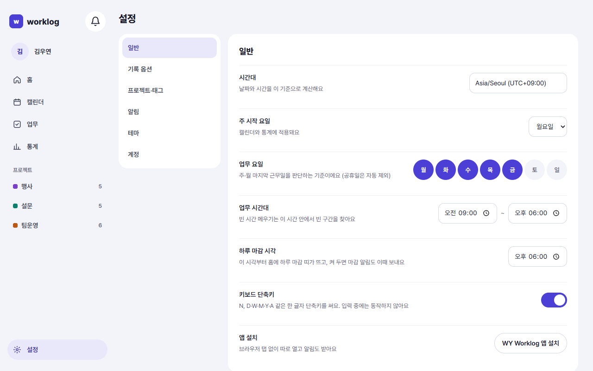
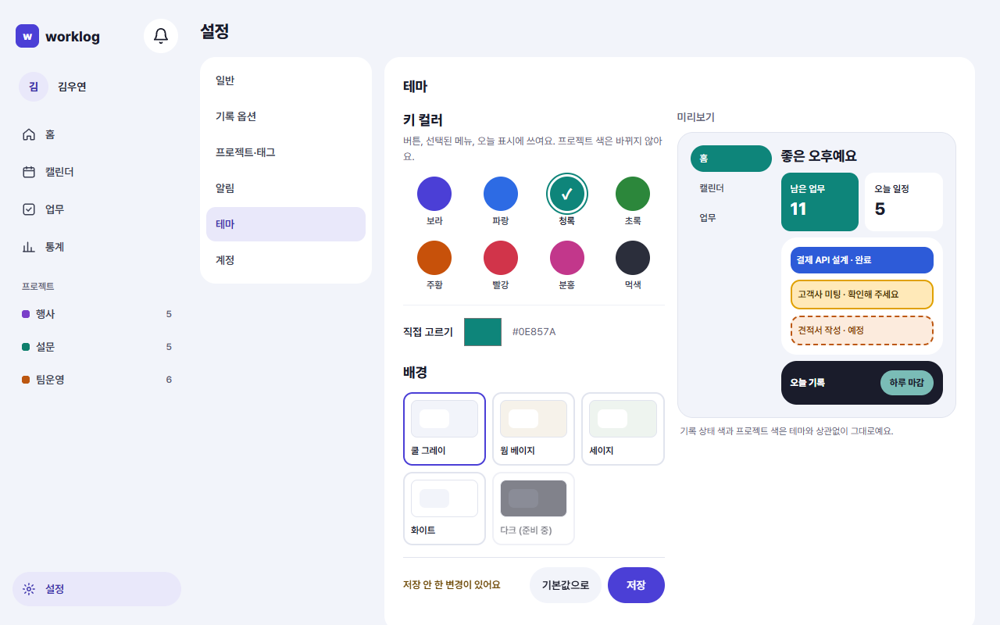
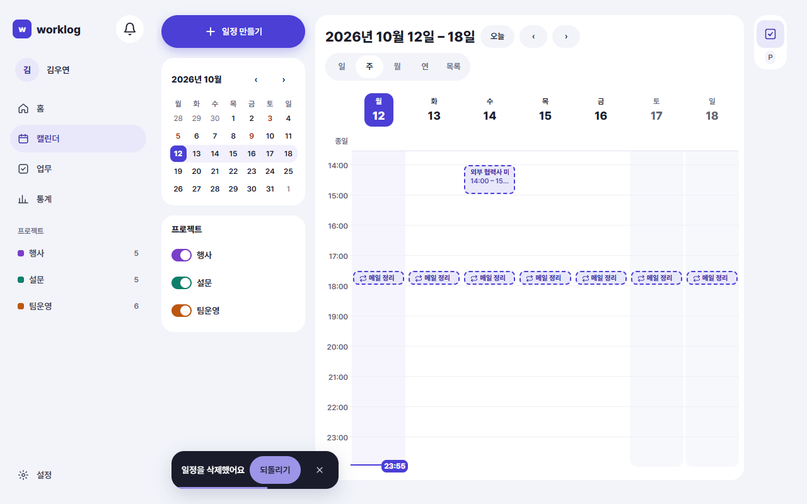

<!-- 담당: WY-ux3. 규칙·화면 목록은 README.md 장 배정 -->
<!-- 근거: NOTI-01~, LOG-16, SET-01~, UX-SET-140·171, UX-COM-02, SCR-COM-04·05, SCR-SET-02·04·05·06, D-173, D-184, D-206, D-213, D-214·D-215(프로필 탭·미인증 안내·일지 알림 숨김). 화면 문구는 NotificationList·NotificationSettings·format.ts·GeneralSettings·DailyCloseSetting·ThemeSettings·AccountSettings·Toast 코드 기준(feature/records-only 2026-10-12) -->
# 9. 알림과 설정

이 장을 읽으면 하루 마감 알림을 받고, 하루 마감 시각과 테마를 바꾸고, 실수한 동작을 되돌리는 방법을 알 수 있어요.

## 알림 센터

알림은 앱 안의 알림 센터에 모여요. 지금 받는 알림은 **하루 마감 알림** 하나예요.

- 웹: 위쪽의 **종 모양 버튼**을 누르면 알림 목록이 열려요. 안 읽은 알림이 있으면 개수가 보여요.
- 모바일: 종 버튼을 누르면 알림 화면이 전체 화면으로 열려요. 왼쪽 위 **뒤로**로 돌아와요.

알림 한 줄에는 이런 것들이 있어요.

- 제목 "하루 마감 시간이에요"
- 설명: 확인 대기가 있으면 "확인 대기 3건이 있어요. 1분이면 끝나요", 없으면 "오늘 남긴 기록을 확정해 하루를 마감해요"
- 받은 시각(오늘 18:00 · 어제 18:05 · 10월 1일 …)
- 아직 안 읽은 알림은 점이 보여요

알림을 누르면 읽음으로 바뀌고, 홈 화면에서 그날의 **하루 마감** 창이 열려요(4장). 지난 날의 알림이면 그 날짜의 하루 마감이 열려요.

| 하고 싶은 일 | 방법 |
|---|---|
| 한꺼번에 읽음 처리 | 안 읽은 알림이 있을 때 목록 위에 보이는 **모두 읽음** |
| 오래된 알림 보기 | 목록 아래의 **이전 알림 더 보기** |
| 알림 설정으로 가기 | 목록 아래의 **알림 설정** |

알림이 하나도 없는데 하루 마감 알림도 꺼져 있다면 "하루 마감 알림이 꺼져 있어요"와 **하루 마감 알림 켜기** 버튼이 보여요. 켜 둔 뒤 알림이 없을 때는 "새 알림이 없어요"가 보여요.

## 알림 켜기와 브라우저 허용

**설정 › 알림**에서 정해요. 처음에는 꺼져 있어요.

1. **하루 마감 알림**을 켜요. 켜면 하루 마감 시각에 알림 센터에 알림이 들어와요. 확인 대기가 있으면 개수도 함께 알려 줘요.
2. 앱을 닫아 둬도 받고 싶다면 아래 **브라우저 푸시 알림**의 **허용하기**를 눌러요. 이때 브라우저가 허용 여부를 한 번 물어봐요.

앱이 먼저 알아서 허용을 묻지는 않아요. 알림을 켠 뒤 **허용하기**를 눌러야 브라우저의 허용 창이 떠요.

푸시 알림 줄에는 이 기기의 상태가 보여요.

| 상태 | 뜻과 할 일 |
|---|---|
| 아직 묻지 않음 | **허용하기**를 눌러요 |
| 이 기기 켜짐 | 앱을 닫아도 받아요. 끄려면 **이 기기에서 끄기** |
| 이 기기 꺼짐 | **이 기기에서 켜기**로 다시 켜요 |
| 차단됨 | 브라우저에서 막았어요. 주소창 왼쪽 **사이트 정보** 아이콘 → **알림** → **허용**으로 바꾼 뒤 이 화면을 새로 고쳐요 |
| 지원 안 함 | 이 브라우저는 푸시를 못 받아요. 알림 센터로만 알려 줘요 |

- 허용하지 않거나 차단해도 알림은 **앱 안 알림 센터**에 모여요. 푸시는 덤이에요.
- iPhone에서는 WY Worklog를 **홈 화면에 추가**해서 열어야 푸시를 받을 수 있어요(1장).
- **로그아웃**하면 이 기기의 푸시 알림은 꺼져요. 다시 로그인한 뒤 필요하면 **이 기기에서 켜기**를 눌러요.

## 하루 마감 시각

**설정 › 일반**의 **하루 마감 시각**이에요. 기본은 18:00이에요.

- 이 시각부터 홈 화면에 **하루 마감 띠**가 떠요.
- 하루 마감 알림을 켜 두었다면 알림도 이 시각에 와요.
- 설정 › 알림의 **알림 시각**은 같은 값이에요. 누르면 설정 › 일반으로 가요.

시각을 바꾸고 칸에서 벗어나면 바로 저장돼요.

## 설정 한눈에 보기

사이드바(모바일은 더보기)의 **설정**으로 들어가요. 웹은 왼쪽에 메뉴가 있고, 모바일은 목록에서 하나를 누르면 그 화면이 열려요. 위쪽 **‹ 설정**으로 목록에 돌아와요.

| 메뉴 | 여기서 하는 일 | 자세한 설명 |
|---|---|---|
| 일반 | 시간대, 주 시작 요일, 업무 요일, 업무 시간대, 하루 마감 시각, 키보드 단축키, 앱 설치 | 이 장 |
| 기록 옵션 | 시간 기록(타이머 등) 켜고 끄기 | 8장 |
| 프로젝트·태그 | 프로젝트와 태그 관리 | 5장 |
| 알림 | 하루 마감 알림, 푸시 | 이 장 |
| 테마 | 키 컬러와 배경 | 이 장 |
| 계정 | 이메일 인증, 비밀번호 변경, 로그아웃 | 이 장 |

### 일반

바꾸면 바로 저장되고, 제목 옆에 잠깐 **✓ 저장됨**이 보여요. 따로 저장 버튼은 없어요.

| 항목 | 설명 |
|---|---|
| 시간대 | 날짜와 시간을 이 기준으로 계산해요. 바꿔도 기존 기록의 날짜는 그대로이고 시각 표시만 바뀌어요 |
| 주 시작 요일 | 캘린더와 통계의 한 주가 시작하는 요일이에요 |
| 업무 요일 | 주·월 마지막 근무일을 판단하는 기준이에요(공휴일은 자동으로 빠져요). 하루 이상 골라야 해요 |
| 업무 시간대 | 빈 시간 메우기가 빈 구간을 찾는 시간이에요(8장). 종료는 시작보다 늦어야 해요 |
| 하루 마감 시각 | 위에서 설명했어요 |
| 키보드 단축키 | N, D·W·M·Y·A 같은 한 글자 단축키예요. 입력 중에는 동작하지 않아요 |
| 앱 설치 | 브라우저가 설치 창을 줄 수 있을 때만 보여요(1장) |

### 테마

키 컬러(버튼·선택된 메뉴·오늘 표시의 색)와 배경을 바꿔요. 프로젝트 색과 기록 상태의 색은 바뀌지 않아요.

1. **키 컬러**를 고르거나 **직접 고르기**로 원하는 색을 정해요. 기본 색이 8가지 있어요.
2. **배경**을 네 가지(쿨 그레이·웜 베이지·세이지·화이트) 중에서 골라요. 다크는 아직 준비 중이에요.
3. 오른쪽(모바일은 아래)의 **미리보기**에서 홈 화면이 어떻게 보일지 확인해요. 고르는 동안은 저장 전이라 앱 전체는 그대로예요. 저장하지 않은 변경이 있으면 "저장 안 한 변경이 있어요"가 보여요.
4. **저장**을 누르면 "저장했어요. 앱 전체에 적용됐어요"가 나오고 바로 적용돼요. **기본값으로**를 누르면 처음 색으로 돌아가요.

너무 옅은 색을 고르면 버튼이 잘 안 보인다고 알려 주고 더 진한 색을 권해 줘요.

### 계정

계정 화면에는 가입한 이메일이 보이므로 이 설명서에서는 예시 주소(`name@example.com`) 그림으로 대신해요.

- **이메일 인증**: 인증이 끝나면 **인증됨**이 보여요. 아직이면 **인증하기**가 보여요(1장).
- **비밀번호 변경**: 현재 비밀번호, 새 비밀번호, 새 비밀번호 확인을 넣고 **비밀번호 변경**을 눌러요. 바꾸면 **다른 기기에서 로그아웃**돼요. 지금 쓰는 기기는 그대로예요. 현재 비밀번호를 여러 번 틀리면 잠시 바꿀 수 없어요.
- **로그아웃**
- **개인정보 처리방침**·**이용약관**: 읽어 볼 수 있어요.
- **회원 탈퇴**: 되돌릴 수 없는 작업이라 로그아웃과 떨어진 맨 아래에 따로 있어요.

## 되돌리기

일정을 지우거나 업무를 완료하는 것처럼 바로 실행되는 동작은 화면 아래에 **되돌리기** 버튼이 있는 토스트가 5초 동안 떠요.

- 5초 안에 **되돌리기**를 누르거나 **Ctrl+Z**(Mac은 **⌘Z**)를 누르면 방금 한 동작이 취소돼요.
- 마우스를 토스트 위에 올리거나 토스트에 포커스가 있으면 사라지지 않고 기다려요.
- 같은 종류의 동작을 연달아 하면 하나로 모아 "일정 2개를 삭제했어요"처럼 알려 줘요. 되돌리면 나중에 한 동작부터 돌아와요.
- 글자를 입력하는 칸에서 **Ctrl+Z**는 글자 되돌리기예요. 칸이 비어 있으면 토스트 되돌리기로 넘어가요.
- 앱을 닫거나 탭을 숨기면 그 순간 동작이 확정돼서 되돌릴 수 없어요.

되돌릴 수 있는 동작의 예예요.

| 동작 | 토스트 문구 |
|---|---|
| 일정 삭제 | 일정을 삭제했어요 |
| 반복 일정 전체 옮기기 | 모든 일정을 옮겼어요 |
| 업무 완료 | 업무 n개를 완료했어요 |
| 확인 대기 처리 | n건을 했어요로 기록했어요 / n건을 안 했어요로 표시했어요 |
| 업무를 일정에 넣기 | 업무를 일정에 넣었어요 |

> 타이머를 멈춘 것은 되돌릴 수 없어요. 멈추기 전에 확인해 주세요(8장).

## 사용 설명서

이 설명서는 PDF로도 받을 수 있어요.

<!-- 확인 필요(WY-planner·WY-design): 앱과 랜딩에서 PDF로 가는 링크의 위치·문구가 아직 코드에 없다(docs/개정대기.md에서 정하는 중). 정해지면 이 절에 "어디의 어떤 버튼"인지 적는다. SCR-COM-04는 README 배정표에서 되돌리기 토스트로 보고 썼다 -->

<!-- 촬영 목록: 파일 이름 | 화면 ID | W/M | 찍을 상태
SCR-COM-05_W.png | SCR-COM-05 | W | 종 버튼을 눌러 연 알림 목록, 안 읽은 알림 1~2개와 읽은 알림이 섞인 상태
SCR-SET-05_W.png | SCR-SET-05 | W | 알림 설정, 하루 마감 알림 켜진 상태, 푸시 줄 "아직 묻지 않음"
SCR-SET-02_W.png | SCR-SET-02 | W | 설정 일반, 하루 마감 시각 줄이 보이게
SCR-SET-04_W.png | SCR-SET-04 | W | 테마, 키 컬러 하나를 고르고 미리보기가 보이는 상태
SCR-SET-06_W_예시주소.png | SCR-SET-06 | W | 계정 화면. 실제 메일이 보이므로 찍지 않고 예시 주소(name@example.com) 그림으로 만들거나 이메일 칸을 가려서(D-206) 찍는다
SCR-COM-04_W.png | SCR-COM-04 | W | 일정을 삭제한 직후의 되돌리기 토스트 -->
<!-- 자주 묻는 질문 후보: 알림이 안 와요(알림 켜기·허용하기·차단됨 확인, 알림 센터엔 쌓임) / 하루 마감 시각을 바꿨는데 알림 시각은요(같은 값) / 테마를 바꿨는데 안 바뀌어요(저장을 눌렀는지) / 실수로 지웠어요(5초 되돌리기, Ctrl+Z) / iPhone에서 푸시가 안 와요(홈 화면에 추가) / 로그아웃했더니 푸시가 안 와요 / 다른 기기에서 로그아웃됐어요(비밀번호 변경) -->
